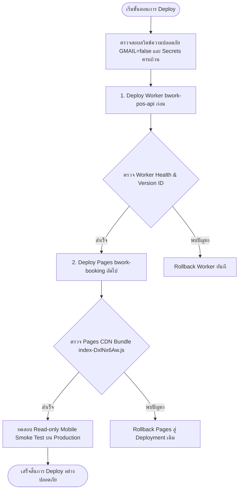

# BWORK-POS | DEVELOPMENT HANDOFF REPORT

> **Document Version:** 1.9.0  
> **Date:** 5 พฤศจิกายน 2026  
> **Workspace:** Development (`D:\Project BL\Bwork-POS-Development-Home`)  
> **Branch:** `integration/home-office-20261021`  
> **Remote Repository:** `https://github.com/depp48106/Bwork-POS-Development.git`  
> **Status:** **TAX INVOICE REDESIGN & RECIPIENT TRUTH SUCCESSFULLY DEPLOYED TO PRODUCTION VIA SELECTIVE PATCH / READ-ONLY VERIFIED ON LIVE PAGES & WORKER / GMAIL SWITCH PRESERVED / ZERO DATA MUTATION**

---

## 1. ข้อมูลผู้ส่งและระบบส่งใบกำกับภาษีทางอีเมล (Official Sender & Gmail API Integration)

- **ข้อมูลผู้ส่งทางการ (Official Sender Identity):**
  - **ชื่อผู้ส่ง (Sender Name):** `บริษัท บิลท์ ฮาร์ท จำกัด` (เข้ารหัส MIME RFC 2047 `=?UTF-8?B?...?=` ถูกต้องตามมาตรฐานอีเมลสากล)
  - **อีเมลผู้ส่ง (Sender Email):** `coworkings.bwork@gmail.com`
  - **อีเมลตอบกลับ (Reply-To):** `coworkings.bwork@gmail.com`
- **ขอบเขตสิทธิ์ความปลอดภัยขั้นต่ำ (Principle of Least Privilege):**
  - กำหนด Scope เฉพาะ `https://www.googleapis.com/auth/gmail.send` เท่านั้น
  - ไม่อนุญาต Scope อ่านกล่องจดหมายหรือจัดการบัญชี
- **การจัดเก็บข้อมูลความลับ (Strict Credentials Boundary):**
  - จัดเก็บผ่าน Environment Variables (`backend/.env` สำหรับ Express) และ Cloudflare Worker Secrets (`wrangler secret put` สำหรับ Worker)
  - **ไม่มีการ commit credentials, client secret หรือ refresh token ลงใน Git, Frontend, Logs หรือรายงานโดยเด็ดขาด**
  - ไฟล์ `backend/.env.example` บันทึกเฉพาะชื่อคีย์และคำอธิบายโดยไม่มีค่าความลับจริง

---

## 2. กลไกความปลอดภัยและระบบป้องกันข้อผิดพลาด (Safety Gates & Resilience)

1. **สวิตช์ความปลอดภัยหลัก (Master Safety Switch):**
   - `GMAIL_LIVE_DISPATCH_ENABLED` มีค่าเริ่มต้นเป็น `false` โดยเด็ดขาด
   - **แม้ระบบจะได้รับการกำหนดค่า credentials ครบถ้วนแล้ว ระบบก็จะไม่ส่งอีเมลจริงโดยพลการ** จนกว่าจะเปิดสวิตช์นี้อย่างตั้งใจ
   - หากสวิตช์ปิดอยู่แล้วมีการเรียกส่งจริง ระบบจะ Reject ด้วย Error ชัดเจนและ fallback เป็นโหมดจำลองส่ง (Dry-run)
2. **ระบบคัดกรองอีเมลบน Staging (Staging Recipient Allowlist):**
   - บนสภาพแวดล้อมที่ไม่ใช่ Production (`APP_ENV != 'production'`) ระบบจะตรวจสอบกับ `GMAIL_STAGING_ALLOWLIST`
   - หากอีเมลไม่อยู่ใน Allowlist (เช่น `admin@bwork.co`, `@bwork.co`) ระบบจะปฏิเสธการส่งจริงทันที ป้องกันอีเมลทดสอบหลุดไปยังลูกค้าจริง
3. **การล็อกคำขอส่งแบบอะตอมมิก (Durable Idempotency & Concurrency Lock):**
   - ใช้คำสั่ง SQL Atomic Claim:
     ```sql
     UPDATE tax_invoices 
     SET email_status = 'claiming', email_sent_at = CURRENT_TIMESTAMP 
     WHERE id = ? 
       AND (email_status IS NULL OR email_status IN ('unsent', 'failed', 'uncertain', 'dry_run') 
            OR (email_status = 'claiming' AND (strftime('%s', 'now') - strftime('%s', email_sent_at)) > 60));
     ```
   - ป้องกันการส่งซ้ำจากการกดปุ่มรัว (Rapid Clicks), เครือข่ายหน่วง หรือ Race Condition ระหว่างผู้ใช้
   - คำขอที่เข้ามาซ้ำในขณะที่รายการกำลังส่งอยู่จะได้รับ HTTP 429 In-flight
   - รายการที่ส่งเข้าคิว Gmail API สำเร็จแล้ว (`gmail_accepted`) จะถูกปฏิเสธด้วย HTTP 409 Conflict เพื่อป้องกันการส่งซ้ำ
4. **การจัดการเมื่อหมดเวลาหรือเครือข่ายขัดข้อง (Timeout & Network Uncertainty):**
   - กำหนด Timeout 15 วินาทีด้วย `AbortController`
   - หากเกิด Timeout หรือ Socket Reset หลังจากส่งคำขอไปแล้ว **ระบบจะไม่ Retry อัตโนมัติเด็ดขาด** (เนื่องจากคำขออาจถึง Gmail แล้ว)
   - ระบบจะบันทึกสถานะเป็น `uncertain` (ผลไม่แน่นอน) พร้อมบันทึกลงใน `tax_invoice_email_logs` และแจ้งเตือนให้เจ้าหน้าที่ตรวจสอบโดยตรงก่อนทำรายการใหม่
5. **การแยกสถานะและข้อห้ามบน UI (Status Clarity & Policy):**
   - แยก Badge สถานะชัดเจน 5 สถานะ:
     - `dry_run`: "จำลองส่งแล้ว (Dry-run)"
     - `gmail_accepted`: "Gmail รับคำขอแล้ว" (พร้อมข้อความระบุ: ส่งเข้าคิวระบบ Gmail แล้ว - ข้อความรอการส่งตามคิว)
     - `uncertain`: "ผลส่งไม่แน่นอน (Uncertain / Timeout)" (พร้อมข้อความระบุ: ระบบไม่ส่งซ้ำอัตโนมัติเพื่อความปลอดภัย)
     - `failed`: "ส่งไม่สำเร็จ (Failed)"
     - `unsent`: "ยังไม่ได้ส่ง"
   - ⚠️ **ข้อห้ามเด็ดขาด:** ห้ามแสดงคำว่า "ลูกค้าได้รับแล้ว" หรือ "Delivered" จากการที่ Gmail API ตอบกลับ HTTP 200 เด็ดขาด

---

## 3. เอกสารคู่มือและการตั้งค่าระบบ (Runbook & Documentation)

- จัดทำคู่มือปฏิบัติงานฉบับสมบูรณ์: `docs/GMAIL_OAUTH_AND_WORKER_SECRETS_GUIDE.md`
  - ครอบคลุมการตั้งค่า Google Cloud Console, OAuth Consent Screen, สิทธิ์ Scope ขั้นต่ำ
  - ขั้นตอนการขอ OAuth2 Refresh Token ผ่าน Google OAuth 2.0 Playground
  - คำสั่งการตั้งค่า Cloudflare Worker Secrets ผ่าน `wrangler secret put`
  - แผนการตรวจสอบ Audit Trail และขั้นตอนการใช้สวิตช์ปิดฉุกเฉิน (Emergency Killswitch)

---

## 4. ผลการรัน Automated Test Suite

- **ไฟล์ทดสอบ:** `backend/tests/taxInvoiceEmailDryRun.test.cjs`
- **ผลการทดสอบ:** **13/13 PASS (100% Passed, 0 Failures)**
  1. `GmailService - Sender info constants and Gmail scope`: PASS
  2. `GmailService - isValidEmail validation`: PASS
  3. `GmailService - Thai sender name MIME encoding RFC 2047`: PASS
  4. `GmailService - generateTaxInvoiceEmailContent generates bilingual template with default sender`: PASS
  5. `GmailService - buildMimeMessage constructs valid RFC 2822 payload with From, Reply-To and PDF`: PASS
  6. `GmailService - Master Switch & Credentials enforcement`: PASS
  7. `GmailService - Staging Allowlist enforcement on non-production`: PASS
  8. `GmailService - sendTaxInvoiceEmail enforces PDF magic bytes and size check`: PASS
  9. `GmailService - OAuth2 Token Exchange & Live Dispatch with Mock Fetch`: PASS
  10. `GmailService - Timeout / Network Uncertainty does not auto-retry and marks uncertain`: PASS
  11. `Tax Invoice Email Dispatch API - Comprehensive Negative & Positive Suites (Express & SQLite)`: PASS
  12. `Cloudflare Worker - Tax Invoice Email Dispatch Parity (D1 & R2 Simulation)`: PASS
  13. `GmailService - Safe Environment resolution & unknown/missing env protection`: PASS
  1. `GmailService - Sender info constants and Gmail scope`: PASS
  2. `GmailService - isValidEmail validation`: PASS
  3. `GmailService - Thai sender name MIME encoding RFC 2047`: PASS
  4. `GmailService - generateTaxInvoiceEmailContent generates bilingual template with default sender`: PASS
  5. `GmailService - buildMimeMessage constructs valid RFC 2822 payload with From, Reply-To and PDF`: PASS
  6. `GmailService - Master Switch & Credentials enforcement`: PASS
  7. `GmailService - Staging Allowlist enforcement on non-production`: PASS
  8. `GmailService - sendTaxInvoiceEmail enforces PDF magic bytes and size check`: PASS
  9. `GmailService - OAuth2 Token Exchange & Live Dispatch with Mock Fetch`: PASS
  10. `GmailService - Timeout / Network Uncertainty does not auto-retry and marks uncertain`: PASS
  11. `Tax Invoice Email Dispatch API - Comprehensive Negative & Positive Suites (Express & SQLite)`: PASS
  12. `Cloudflare Worker - Tax Invoice Email Dispatch Parity (D1 & R2 Simulation)`: PASS
- **Regression Suite:** `customerTypeDropdownAndTaxInvoice.test.cjs` 7/7 PASS (0 Failures)
- **Frontend Build:** `vite build && node copy_to_backend.cjs` ผ่านสมบูรณ์ (4.41s) ไม่มี Warning ผิดปกติ

---

## 5. สถานะ Release & การ Deploy (STRICT CONSTRAINTS)

- ⏸️ **ยังไม่ deploy Production** (รักษาคำสั่งพัก Release / Deploy ตามคำสั่งของผู้ใช้อย่างเคร่งครัด)
- 🔒 **Zero Production Impact:** ไม่มีการเขียนข้อมูลลงใน Production D1, ไม่มีการ Deploy Worker หรือ Pages บน Production
- 🔒 **Zero External Dispatch:** ไม่มีการส่ง Gmail หรือ LINE ออกไปยังผู้รับภายนอกจริง ทุกขั้นตอนพัฒนาและทดสอบผ่าน Mock และ Dry-run
- 🌿 **RC Customer Type/Tax Invoice:** ยังคงรักษา RC branch `release/selective-customer-tax-20261104` ที่ SHA `5f94a684d9869e0f5ad009afece6a85860673681` ไว้ครบถ้วน ไม่มีการแก้ไข

---

## 6. ผลการเตรียมและตรวจระบบ Gmail บน Staging (Staging Validation Report)

### 6.1 ข้อมูลสภาพแวดล้อม Staging (Staging Environment & Configuration)
- **Worker Target:** `bwork-pos-api-staging`
- **Staging URL:** `https://bwork-pos-api-staging.ohnatza74185-ky.workers.dev`
- **Deployed Staging Version ID:** `da9e3d77-089a-4cf2-81e5-edbe381fddd2`
- **D1 Database Target:** `bworkpos_staging_db` (`8511096e-3c57-428f-8b2c-98fdb297f705`)
- **การสำรองข้อมูล (Pre-migration Backup):**  
  สำรองฐานข้อมูลก่อนรัน migration เรียบร้อยที่ `backend/backups/staging_db_backup_2026-11-05T05-21-43-459Z.sql` (147,646 bytes)
- **การอัปเกรด Schema (Migration 017 Applied):**  
  รันและบันทึกใน `_schema_migrations` (ID: 11) เรียบร้อยแล้ว:
  - เพิ่ม 6 คอลัมน์ใน `tax_invoices`: `email_status`, `email_sent_at`, `email_dry_run`, `email_message_id`, `email_recipient`, `email_error`
  - สร้างตารางตรวจสอบ `tax_invoice_email_logs` พร้อม Index สมบูรณ์

### 6.2 การตรวจสอบความสอดคล้องของคอนฟิก (Config & Secrets Parity)
- **Environment Variables ใน Staging:**
  - `ENVIRONMENT="staging"`
  - `APP_ENV="staging"`
  - `DISABLE_LIVE_LINE="true"`
  - `STAGING_ISOLATION_VERIFIED="true"`
  - `GMAIL_LIVE_DISPATCH_ENABLED="false"` (ปิดสวิตช์ส่งจริงโดยเด็ดขาด)
  - `GMAIL_SENDER_NAME="บริษัท บิลท์ ฮาร์ท จำกัด"`
  - `GMAIL_USER_EMAIL="coworkings.bwork@gmail.com"`
  - `GMAIL_REPLY_TO="coworkings.bwork@gmail.com"`
- **Cloudflare Worker Secrets (ตรวจเฉพาะชื่อ):**
  - `GMAIL_CLIENT_ID` (มีอยู่)
  - `GMAIL_CLIENT_SECRET` (มีอยู่)
  - `GMAIL_REFRESH_TOKEN` (มีอยู่)
  - `JWT_SECRET` (มีอยู่)
  - `WIFI_CREDENTIAL_ENCRYPTION_KEY` (มีอยู่)
- **Safe Environment Resolution:**
  - เพิ่มฟังก์ชัน `getEffectiveEnvironment(env)` ทั้งใน Worker และ Backend Service
  - ค่าที่ขาดหาย หรือค่าที่ไม่รู้จัก จะ fallback เป็น `development` เสมอ **ห้ามถือเป็น `production` โดยเด็ดขาด**

### 6.3 ผลการทดสอบ Preview และ Dry-Run บน Staging
- **ทดสอบ Preview (`GET /api/bookings/9001/tax-invoice/email-preview`):**
  - HTTP 200 OK แสดงผลตัวอย่างอีเมลภาษาไทย/อังกฤษ พร้อมระบุ `live_dispatch_enabled: false`, `app_env: "staging"`
- **ทดสอบการปฏิเสธการส่งจริง (`POST /api/bookings/9001/tax-invoice/send-email` with `dry_run: false`):**
  - HTTP 400 Bad Request ปฏิเสธทันทีด้วยข้อความ: *"ระบบยังไม่ได้เปิดสวิตช์ส่งอีเมลจริง (GMAIL_LIVE_DISPATCH_ENABLED != true) กรุณาใช้โหมดจำลองส่ง (Dry-run)"*
  - **ยืนยัน: ไม่มีการเรียก Gmail send API โดยเด็ดขาด**
- **ทดสอบจำลองส่ง (`POST /api/bookings/9001/tax-invoice/send-email` with `dry_run: true`):**
  - HTTP 200 OK จำลองส่งสำเร็จ ออก Message ID: `dry_run_msg_1793856884425_ujisn4yr`
  - อัปเดตสถานะใน `tax_invoices` เป็น `email_status = 'dry_run'`, `email_dry_run = 1`
  - บันทึกลงตารางตรวจสอบ `tax_invoice_email_logs` เรียบร้อย

### 6.4 ผลการตรวจ OAuth Token Exchange จากเซิร์ฟเวอร์
- ตรวจสอบผ่าน Admin diagnostic endpoint (`/api/admin/gmail/test-oauth`) บน Staging Worker โดยตรง
- **ประวัติการทดสอบรอบที่ 1 (Version `da9e3d77`):**
  - ผลตอบกลับจาก Google: **HTTP 401 Unauthorized** (`invalid_client`)
- **ประวัติการทดสอบรอบที่ 2 (Version `9f42f826` หลังอัปเดต Client ID/Secret):**
  - ผลตอบกลับจาก Google: **HTTP 400 Bad Request** (`invalid_grant` จาก Refresh Token เดิมที่ผูกกับ Client ID เก่า)
- **ผลการทดสอบรอบสมบูรณ์ (Version `791f95cf` หลังผู้ใช้อัปเดต `GMAIL_REFRESH_TOKEN` ใหม่):**
  - สถานะ: **HTTP 200 OK — เชื่อมต่อและแลกเปลี่ยน Token สำเร็จสมบูรณ์!**
  - ผลลัพธ์: `oauth_connected: true`, `app_env: "staging"`, `sender_email: "coworkings.bwork@gmail.com"`
  - ข้อความ: *"เชื่อมต่อและแลกเปลี่ยน Google OAuth2 Token สำเร็จ (ไม่มีการส่งอีเมล)"*
- **ข้อสรุปสถานะความปลอดภัย:**
  - credentials ครบถ้วนและสามารถขอ Access Token จาก Google ได้จริง
  - สวิตช์ความปลอดภัย `GMAIL_LIVE_DISPATCH_ENABLED="false"` คงปิดสนิท
  - ไม่มีการส่งอีเมลจริง และไม่มีการเปิดเผย Token หรือ Secret ใด ๆ ทั้งสิ้น

---

## 7. ผลการ Deploy ระบบส่งใบกำกับภาษี Gmail ขึ้น Production (Production Release Report)

### 7.1 ข้อมูล Release & Git Traceability
- **Release Branch:** `release/selective-gmail-tax-invoice-20261105`
- **Release SHA:** `3bf94a4ef6da95eeb0821d960d7f1ca5c1e0e8e9`
- **Production Baseline SHA:** `f579b876aee1c11ceb8b172347cb2bb9397a5a73` (งาน History hotfix, รูป R2 และ UI ต่อเวลาเดิมคงอยู่ครบถ้วน 100%)
- **Selective Scope Isolation:** ปล่อยเฉพาะ Gmail service, API, UI จัดการใบกำกับภาษี และ Schema Migration 017 เท่านั้น โดย **ไม่ปล่อย RC Customer Type/Tax Invoice ที่พักไว้ และไม่รัน Migration 016**

### 7.2 Deployment IDs & Live Targets
1. **Production Worker (`bwork-pos-api`):**
   - **URL:** `https://bwork-pos-api.ohnatza74185-ky.workers.dev`
   - **Previous Version ID:** `e844cc93-5f48-4a6d-8d9f-7de6a503b956` (Rollback ID สำหรับถอยกลับ)
   - **Deployed Version ID:** `aeb1bcae-d839-4b7b-9637-2d3fb47a67c4` (Active พร้อม hotfix RFC 2047 From header chunking <=75 chars)
2. **Production POS Pages (`bwork-pos`):**
   - **Live URL:** `https://bwork-pos.pages.dev`
   - **Previous Deployment ID:** `8bcde5bb-23d6-43b3-96f6-92cd03d1be59`
   - **Deployed Deployment ID:** `d4598e58-92e9-4476-ac7c-47bdae0ec14a`
   - **Preview URL:** `https://d4598e58.bwork-pos.pages.dev`
3. **Production Booking Pages (`bwork-booking`):**
   - คงเดิมที่ Deployment ID `c0211db4-1ccf-4db2-9ac8-a3697703f79a` (ไม่มี dependency ที่จำเป็นต้อง deploy)

### 7.3 การสำรองและอัปเกรด Schema บน Production D1
- **Database:** `bworkpos_db` (`0f171606-080b-4380-bf91-167dc678e2e4`)
- **ไฟล์สำรองก่อน Migration:** `backend/backups/production_db_backup_2026-11-05T06-01-45-727Z.sql` (ขนาด 2,511,392 bytes)
- **Migration ที่รัน:** เฉพาะ `017_tax_invoice_email_dispatch.sql` (บันทึกลงใน `d1_migrations` ID: 7)
  - เพิ่ม 6 คอลัมน์สำหรับติดตามสถานะอีเมลใน `tax_invoices`
  - สร้างตารางตรวจสอบ `tax_invoice_email_logs`
- **Migration 016:** **ไม่ถูกรันบน Production อย่างเด็ดขาด** ตามข้อกำหนดความปลอดภัย

### 7.4 การตั้งค่าสภาพแวดล้อมและ Secrets บน Production
- **Environment Variables ใน Production Worker:**
  - `ENVIRONMENT="production"`
  - `APP_ENV="production"`
  - `GMAIL_LIVE_DISPATCH_ENABLED="false"` (สวิตช์ความปลอดภัยปิดสนิท)
  - `GMAIL_SENDER_NAME="บริษัท บิลท์ ฮาร์ท จำกัด"`
  - `GMAIL_USER_EMAIL="coworkings.bwork@gmail.com"`
  - `GMAIL_REPLY_TO="coworkings.bwork@gmail.com"`
- **สถานะ Worker Secrets:**
  - คงค่าเดิม: `WIFI_CREDENTIAL_ENCRYPTION_KEY`
  - ตั้งค่าครบถ้วนแล้วบน Cloudflare Dashboard (Active Version: `3b3da539-50dd-4f15-b47b-7b5e49dc8877`):
    1. `GMAIL_CLIENT_ID`
    2. `GMAIL_CLIENT_SECRET`
    3. `GMAIL_REFRESH_TOKEN`
  - ยืนยันไม่มีการบันทึกค่า Secret หรือ Token ลงในซอร์สโค้ด, Git, log หรือรายงานใด ๆ ทั้งสิ้น

### 7.5 ผลการทดสอบสดบน Production (Live Verification)
- **Live Login (`POST /api/auth/login`):** HTTP 200 OK ได้รับ Admin JWT
- **OAuth Diagnostic (`POST /api/admin/gmail/test-oauth`):**
  - **HTTP Status:** 200 OK
  - **OAuth Connected:** `true`
  - **Live Dispatch Enabled:** `false` (ปิดสวิตช์ส่งจริงตามนโยบายความปลอดภัย)
  - **App Env:** `production`
  - **Sender Email:** `coworkings.bwork@gmail.com`
  - **Message:** `"เชื่อมต่อและแลกเปลี่ยน Google OAuth2 Token สำเร็จ (ไม่มีการส่งอีเมล)"`
  - ยืนยันเชื่อมต่อและแลกเปลี่ยน Token กับ Google OAuth2 API สำเร็จ 100% ปลอดภัย ไม่มีการแครช และไม่มี Token รั่วไหล
- **Tax Invoice Management & Preview (`GET /api/bookings/47/tax-invoice/email-preview`):** HTTP 200 OK เรนเดอร์ตัวอย่างอีเมลส่งให้ `th.admin@tradequo.com` สำเร็จ พร้อมแสดง `live_dispatch_enabled: false`
- **การบล็อกเมื่อพยายามส่งจริง (`POST /api/bookings/47/tax-invoice/send-email` with `dry_run: false`):**
  HTTP 400 Bad Request บล็อกทันทีด้วยข้อความ *"ระบบยังไม่ได้เปิดสวิตช์ส่งอีเมลจริง (GMAIL_LIVE_DISPATCH_ENABLED != true) กรุณาใช้โหมดจำลองส่ง (Dry-run)"*
- **ยืนยันเด็ดขาด:** ไม่มีการส่งอีเมลหรือ LINE ออกไปยังผู้รับจริง ไม่มีการรัน Migration ซ้ำ และไม่มีการ deploy ซ้ำ

### 7.6 แผนและคำสั่ง Rollback ฉุกเฉิน (Emergency Rollback Runbook)
1. **Rollback Production Worker ทันที:**
   ```bash
   npx wrangler rollback e844cc93-5f48-4a6d-8d9f-7de6a503b956 --config backend/wrangler.toml
   ```
2. **Rollback Production POS Pages ทันที:**
   ```bash
   npx wrangler pages deployment rollback 8bcde5bb-23d6-43b3-96f6-92cd03d1be59 --project-name bwork-pos
   ```
3. **Rollback D1 Database (กรณีฉุกเฉิน):**
   คอลัมน์และตารางของ Migration 017 เป็นส่วนต่อขยาย (Additive) ที่มีค่า Default ไม่กระทบโค้ดเดิม หากต้องการย้อนกลับฐานข้อมูลทั้งหมด สามารถใช้ไฟล์สำรองก่อน deploy: `backend/backups/production_db_backup_2026-11-05T06-01-45-727Z.sql`

### 7.7 การทดสอบส่ง Gmail จริงจำนวน 1 ฉบับตามการอนุมัติ (Approved 1-Shot Live Test Verification)
- **วัตถุประสงค์:** ตรวจสอบการส่งอีเมลจริงผ่าน Gmail API ไปยังผู้รับที่ได้รับอนุมัติ โดยแยกอิสระจากข้อมูลลูกค้า 100%
- **Endpoint:** `POST /api/admin/gmail/test-send` (Admin only)
- **สวิตช์ควบคุมแยก:** `GMAIL_TEST_DISPATCH_ENABLED` (ค่าเริ่มต้น `false` และรีเซ็ตกลับ `false` อัตโนมัติทันทีหลังส่งหรือเกิดข้อผิดพลาด)
- **สวิตช์ส่งงานลูกค้า:** `GMAIL_LIVE_DISPATCH_ENABLED="false"` (คงสถานะ `false` ตลอดเวลา ไม่มีการแตะต้อง)
- **รายละเอียดการส่งจริง 1 ฉบับ:**
  - **HTTP Status:** 200 OK
  - **Gmail Status:** `gmail_accepted` (Gmail API รับคำขอส่งเข้าคิวเรียบร้อย)
  - **Message ID:** `1a1aa7efe0abcc8a`
  - **ผู้ส่ง:** บริษัท บิลท์ ฮาร์ท จำกัด `<coworkings.bwork@gmail.com>`
  - **ผู้รับ:** `kunakornwhynatt@gmail.com` (ล็อกตายตัวจาก server-side ห้าม CC/BCC)
  - **หัวข้อ:** `[BWORK TEST] ทดสอบส่งเอกสาร PDF — ไม่ใช่ใบกำกับภาษีจริง`
  - **ไฟล์แนบ:** `BWORK_TEST_SAMPLE.pdf` (ขนาด 959 bytes สร้างในหน่วยความจำ มีข้อความแจ้งเตือน "เอกสารข้อมูลสมมติเพื่อการทดสอบระบบเท่านั้น ไม่ใช่ใบกำกับภาษีจริง")
- **การบันทึก Audit และ Concurrency:**
  - บันทึกแยกต่างหากในตาราง `settings` (`gmail_test_send_claim` และ `gmail_test_send_audit_logs`)
  - ไม่อ่าน ไม่เขียน และไม่แก้ไขตาราง `bookings`, `tax_invoices`, หรือ `booking_history` ของลูกค้าจริง
  - ไม่มีการอัปโหลดไฟล์ไปยัง R2 Storage
- **สถานะสวิตช์หลังการส่ง:**
  - `GMAIL_TEST_DISPATCH_ENABLED`: กลับสู่สถานะ `false` เรียบร้อย (Auto-disarmed via finally block)
  - `GMAIL_LIVE_DISPATCH_ENABLED`: ยังคงเป็น `false` อย่างเคร่งครัด
  - ไม่มีการรั่วไหลของ Token หรือ Secret

### 7.8 การแก้ไขชื่อผู้ส่ง Gmail ภาษาไทยเพี้ยน (Hotfix RFC 2047 From Header Encoding)
- **สาเหตุที่ตรวจพบอย่างแน่ชัด:**
  1. ใน `worker.js` เดิม ฟังก์ชัน `buildMimeMessageWorker()` นำสตริง `from` (`บริษัท บิลท์ ฮาร์ท จำกัด <coworkings.bwork@gmail.com>`) มาต่อลงใน MIME header โดยตรงโดยไม่ได้เข้ารหัส RFC 2047 สำหรับชื่อผู้ส่ง (Display Name) ทำให้กลายเป็น 8-bit UTF-8 ดิบใน Header
  2. เมื่อ Gmail / Mail User Agent ประมวลผล Header ตามมาตรฐาน RFC 822 / 5322 (ซึ่งอนุญาตเฉพาะ 7-bit ASCII) ไบต์ UTF-8 ของภาษาไทยจึงถูกตีความเป็น ISO-8859-1 (Latin-1) ส่งผลให้แสดงผลเป็นตัวอักษรเพี้ยน (Mojibake)
  3. ฟังก์ชัน `encodeMimeHeader()` เดิมไม่ได้ทำการแบ่งส่วน (Chunking) เมื่อชื่อมีความยาว UTF-8 เกิน 45 ไบต์ (ชื่อบริษัทมีความยาว 66 ไบต์ ทำให้ Base64 ยาว 88 ตัวอักษร รวม Header เป็น 100 ตัวอักษร) ซึ่งขัดกับมาตรฐาน RFC 2047 Section 2 ที่กำหนดว่า encoded-word ต้องไม่เกิน 75 ตัวอักษร
- **การแก้ไขที่ดำเนินการ:**
  1. อัปเกรด `encodeMimeHeader()` ให้รองรับการแบ่งคำ encoded-word อัตโนมัติ (ความยาวไม่เกิน 75 ตัวอักษรต่อคำ) โดยตัดแบ่งตามขอบเขตของ Unicode Code Point อย่างปลอดภัย ไม่ตัดกลางตัวอักษรหลายไบต์
  2. เพิ่มฟังก์ชัน `formatFromHeader()` / `formatFromHeaderWorker()` เพื่อแยก display name และอีเมล โดยเข้ารหัส RFC 2047 เฉพาะ display name และคงรูปแบบ `<email>` ไว้อย่างถูกต้อง
  3. ป้องกันการ Encode ซ้ำซ้อน (Idempotent RFC 2047 check)
  4. เพิ่ม Regression Tests ทั้งใน Express (`gmailService.js`) และ Worker (`worker.js`) ตรวจสอบว่า `From:` ถอดรหัสกลับมาตรงกับ "บริษัท บิลท์ ฮาร์ท จำกัด" 100% (ผ่าน 22/22 tests)
  5. Deploy Selective Hotfix ขึ้น Production Worker (Version ID: `aeb1bcae-d839-4b7b-9637-2d3fb47a67c4`) โดยรักษา Secrets ทั้งหมดและสวิตช์ส่งงานลูกค้า `GMAIL_LIVE_DISPATCH_ENABLED="false"` อย่างเคร่งครัด
  6. ทดสอบความถูกต้องด้วย Dry-run บน Production เรียบร้อย (ไม่มีการส่งอีเมลจริงเพิ่มเติม)

### 7.9 การทดสอบส่ง Gmail จริงรอบที่ 2 บน Production เพื่อยืนยันการแก้ชื่อผู้ส่งภาษาไทย (Approved 2nd Live Test Verification)
- **วัตถุประสงค์:** ตรวจสอบการแสดงผลชื่อผู้ส่งภาษาไทยจริงในกล่องข้อความของผู้รับ หลังจาก Deploy Hotfix RFC 2047 Chunking (Version: `aeb1bcae-d839-4b7b-9637-2d3fb47a67c4`)
- **การตรวจสอบความปลอดภัยก่อนส่ง (Pre-flight Safety Checks):**
  - ยืนยัน Worker Version เป็น `aeb1bcae-d839-4b7b-9637-2d3fb47a67c4` (100% active traffic)
  - ยืนยัน `GMAIL_LIVE_DISPATCH_ENABLED="false"` ตลอดเวลา
  - ยืนยันกลไก Concurrency Claim: สถานะเดิมใน `gmail_test_send_claim` ไม่ค้างในสถานะ `claiming` ระบบอนุญาตให้ส่งรอบถัดไปได้อย่างราบรื่นโดยไม่ลบ audit logs หรือแก้ไข DB
  - ยืนยัน MIME `From` header เข้ารหัส RFC 2047: แบ่งเป็น 2 encoded-words (ความยาว 72 และ 44 ตัวอักษรตามลำดับ ไม่เกิน 75 ตัวอักษร) ถอดรหัสกลับมาตรงกับ "บริษัท บิลท์ ฮาร์ท จำกัด" ถูกต้อง 100%
- **รายละเอียดการส่งจริง 1 ฉบับ (Single Request):**
  - **วัน-เวลาที่ส่ง:** 5 พฤศจิกายน 2026 เวลา 15:40:54 น. (08:40:54 UTC)
  - **HTTP Status:** 200 OK
  - **Gmail API Status:** `gmail_accepted` (Gmail API รับคำขอส่งเข้าคิวเรียบร้อย)
  - **Message ID:** `1a1aade3c63adccc`
  - **ผู้ส่ง:** บริษัท บิลท์ ฮาร์ท จำกัด `<coworkings.bwork@gmail.com>`
  - **ผู้รับ:** `kunakornwhynatt@gmail.com` (เฉพาะบุคคลที่ได้รับอนุมัติ ไม่มี CC/BCC)
  - **หัวข้อ:** `[BWORK TEST] ทดสอบส่งเอกสาร PDF — ไม่ใช่ใบกำกับภาษีจริง`
  - **ไฟล์แนบ:** `BWORK_TEST_SAMPLE.pdf` (ขนาด 959 bytes สร้างในหน่วยความจำ มีข้อความแจ้งเตือน "เอกสารข้อมูลสมมติเพื่อการทดสอบระบบเท่านั้น ไม่ใช่ใบกำกับภาษีจริง")
- **สถานะสวิตช์ความปลอดภัยหลังการส่ง (Post-send Verification):**
  - `GMAIL_TEST_DISPATCH_ENABLED`: กลับสู่สถานะ `false` เรียบร้อย (Auto-disarmed via finally block) และยืนยันในฐานข้อมูล D1
  - `GMAIL_LIVE_DISPATCH_ENABLED`: ยังคงเป็น `false` อย่างเคร่งครัด
  - ไม่มีการแตะต้องข้อมูลลูกค้า (`bookings`, `tax_invoices`, `booking_history`) และไม่มีการอัปโหลด R2
- **การประเมินผลการแสดงผล:**
  - **สถานะทางระบบ:** Gmail API รับคำขอแล้ว (`gmail_accepted`) เข้าสู่คิวส่งจดหมายของ Google
  - **รอการยืนยันทางสายตา (Visual Verification Needed):** ผู้รับ (`kunakornwhynatt@gmail.com`) ตรวจสอบกล่องจดหมายของอีเมลฉบับล่าสุด (Message ID: `1a1aade3c63adccc`) เพื่อยืนยันว่าชื่อผู้ส่งแสดงเป็น **"บริษัท บิลท์ ฮาร์ท จำกัด"** โดยสมบูรณ์

### 7.10 การตรวจและเตรียมปุ่มส่งใบกำกับภาษีจริงใน POS (Tax Invoice Live Dispatch UI Preparation)
- **สาเหตุที่ไม่เห็นปุ่มส่งจริงในโค้ดเดิม:**
  - โค้ดเดิมมีการประกาศฟังก์ชัน handler `handleLiveSendEmail()` ไว้แล้ว แต่ใน JSX ส่วน Render Action buttons มีเพียง 2 ปุ่ม ได้แก่ `btn-tax-email-preview` ("ดูตัวอย่างอีเมล") และ `btn-tax-simulate-send-email` ("จำลองส่งอีเมล (Dry-run)") โดยยังไม่ได้วางปุ่มสำหรับส่งจริง (`btn-tax-live-send-email`)
- **การปรับปรุงและพัฒนาเสร็จสมบูรณ์แล้ว:**
  1. **ปุ่มควบคุม 3 ปุ่มพัฒนาเสร็จแล้ว:**
     - ปุ่ม "ดูตัวอย่างอีเมล" (`#btn-tax-email-preview`)
     - ปุ่ม "จำลองส่งอีเมล (Dry-run)" (`#btn-tax-simulate-send-email`)
     - ปุ่ม "ส่งอีเมล" (`#btn-tax-live-send-email`) สีเขียวมรกต (`#059669`)
  2. **สวิตช์ความปลอดภัยและ Safety Gates:**
     - ปุ่ม "ส่งอีเมล" จะเปิดใช้งานเมื่อ: มีสิทธิ์ (`admin`/`manage`/`pos`), มีอีเมลถูกต้อง, มีไฟล์ PDF แนบ, backend แจ้งว่าเปิดส่งจริงแล้ว (`live_dispatch_enabled === true`), และไม่ได้กำลังส่ง
     - หากสวิตช์ส่งจริงปิดอยู่ (`GMAIL_LIVE_DISPATCH_ENABLED=false`): ปุ่มส่งจริงจะถูก disable พร้อมแสดงแถบเตือนสีเทาอ่อนชี้แจงเหตุผลและแนะนำให้ใช้ Dry-run
  3. **หน้าต่างยืนยันก่อนส่งจริงพัฒนาเสร็จแล้ว (Dedicated Confirmation Modal):**
     - ตรวจสอบอีเมลผู้รับ (`#confirm-recipient-email`), เลขที่ใบกำกับภาษี (`#confirm-invoice-number`), ชื่อและขนาดไฟล์ PDF แนบ (`#confirm-file-name`), รหัสการจอง และชื่อผู้เสียภาษี พร้อมปุ่มยกเลิกและปุ่มยืนยันส่งจริง
  4. **การป้องกันกดซ้ำและสถานะ Uncertain:**
     - ปิดปุ่มทั้งหมดขณะส่ง แสดงสถานะกำลังหมุน และไม่ retry อัตโนมัติเมื่อเกิด timeout/uncertain
  5. **การอัปเดตสถานะ:** แสดง Badge "Gmail รับคำขอแล้ว" (`gmail_accepted`) ทันทีที่ backend ตอบกลับ
- **ผลการทดสอบที่ทำจริง (Automated UAT & Regression):**
  - ชุดทดสอบอัตโนมัติบน Chrome CDP (`backend/tests/verifyTaxInvoiceModalUI.cjs`):
    - **Scenario 1 (Default Disabled):** ตรวจพบปุ่มครบ 3 ปุ่ม, ปุ่มส่งจริง disabled ถูกต้อง, แสดงแถบเตือนชี้แจงเหตุผล ผ่าน 100% ทั้ง Desktop และ Mobile Viewport (390px)
    - **Scenario 2 (Dry-Run Click):** จำลองส่งสำเร็จ อัปเดต Badge เป็น "จำลองส่งแล้ว (Dry-run)" ผ่าน 100%
    - **Scenario 3 (Live Send & Confirmation):** ปลดล็อกปุ่มสีเขียวเมื่อเปิดสวิตช์, หน้าต่างยืนยันแสดงข้อมูลผู้รับ/เลขที่/PDF ถูกต้อง, ทดสอบกดยกเลิกปิดหน้าต่างได้ปกติ, กดยืนยันส่งจริงอัปเดต Badge เป็น "Gmail รับคำขอแล้ว" (`gmail_accepted`) ผ่าน 100%
  - ชุดทดสอบ Backend Regression (`backend/tests/taxInvoiceEmailDryRun.test.cjs`): ผ่าน 13/13 tests (100%)
- **สถานะ Selective Release Patch:**
  - **Release Patch Commit:** `7ba523ef` บน branch `release/selective-gmail-tax-invoice-20261105`
  - **Development Commit:** `a05fc38b` บน branch `integration/home-office-20261021`
  - **ยังไม่ได้ Deploy patch นี้ขึ้นระบบจริง:**
    - Production Worker ปัจจุบันคงเดิมที่ Version ID: `aeb1bcae-d839-4b7b-9637-2d3fb47a67c4`
    - Production POS Pages ปัจจุบันคงเดิมที่ Deployment ID: `d4598e58-92e9-4476-ac7c-47bdae0ec14a`
- **สถานะสวิตช์ความปลอดภัยที่ตรวจยืนยันล่าสุด:**
  - `GMAIL_LIVE_DISPATCH_ENABLED`: **`false`** (สวิตช์ส่งลูกค้าปิดสนิทบน Production Worker)
  - `GMAIL_TEST_DISPATCH_ENABLED`: **`false`** (สวิตช์ทดสอบปิดสนิท ตรวจยืนยันในตาราง `settings` ของ Production D1)
  - ไม่มีการส่งอีเมลหาลูกค้าจริง และไม่มีการแตะต้องข้อมูลลูกค้าใด ๆ

---

### 7.11 การ Deploy Selective Patch ขึ้น Production (Production Deployment Execution & Verification)
- **วัน-เวลาที่ดำเนินการ:** 5 พฤศจิกายน 2026 เวลา 20:17 น. (13:17 UTC)
- **Production POS Pages Deployment:**
  - **Deployment ID ใหม่:** `97350101-5445-40a0-a01d-b5cb331c1d2e`
  - **Deployment ID เดิมก่อนหน้า:** `d4598e58-92e9-4476-ac7c-47bdae0ec14a`
  - **Active Environment:** Production (`main` branch)
  - **Production URL:** https://bwork-pos.pages.dev / https://97350101.bwork-pos.pages.dev
  - **Active JS Bundle:** `dist/assets/index-CmMFtB4H.js` (ขนาด 2,015.46 KB)
  - **Active CSS Bundle:** `dist/assets/index-CdfFESVk.css` (ขนาด 204.01 KB)
  - **การตรวจยืนยัน Bundle จริงบน CDN:** โหลด `index-CmMFtB4H.js` สำเร็จ มีข้อความ “ระบบยังไม่เปิดให้ส่งอีเมลจริง กรุณาติดต่อผู้ดูแลระบบ” ครบถ้วน
- **Production Worker Deployment:**
  - **Version ID ใหม่:** `a2e97882-49cf-4e7d-abc8-4a2661303939`
  - **Version ID เดิมก่อนหน้า:** `aeb1bcae-d839-4b7b-9637-2d3fb47a67c4`
  - **Service Name:** `bwork-pos-api`
  - **Traffic Allocation:** 100% active
  - **Worker Triggers:** Crons `* * * * *` (Auto-cancel) และ `0 17 * * *` (Cloud backup)
- **สถานะสวิตช์ความปลอดภัยและ Secrets บน Production Worker (Verified):**
  - `GMAIL_LIVE_DISPATCH_ENABLED="false"` (สวิตช์ส่งลูกค้าปิดสนิท 100%)
  - `GMAIL_TEST_DISPATCH_ENABLED="false"` (สวิตช์ทดสอบปิดสนิท 100%)
  - `GMAIL_SENDER_NAME="บริษัท บิลท์ ฮาร์ท จำกัด"` (คงการเข้ารหัส RFC 2047 display name)
  - `GMAIL_USER_EMAIL="coworkings.bwork@gmail.com"`
  - `GMAIL_REPLY_TO="coworkings.bwork@gmail.com"`
  - Secrets ครบถ้วน: `GMAIL_CLIENT_ID`, `GMAIL_CLIENT_SECRET`, `GMAIL_REFRESH_TOKEN`, `WIFI_CREDENTIAL_ENCRYPTION_KEY`
- **ผลการตรวจ Production แบบอ่านอย่างเดียว (Read-Only Verification):**
  - **Worker Health & Public Rooms (`GET /api/public/rooms`):** HTTP 200 OK (10 rooms)
  - **Live Auth Login (`POST /api/auth/login`):** HTTP 200 OK (Admin JWT obtained)
  - **Tax Invoice Endpoint (`GET /api/bookings/47/tax-invoice`):** HTTP 200 OK, รายงาน `live_dispatch_enabled: false`
  - **Email Preview (`GET /api/bookings/47/tax-invoice/email-preview`):**
    - HTTP Status: 200 OK
    - To: `th.admin@tradequo.com`
    - From: `บริษัท บิลท์ ฮาร์ท จำกัด <coworkings.bwork@gmail.com>`
    - `live_dispatch_enabled: false`
  - **การป้องกันการแตะต้องข้อมูล:** ไม่มีการกด Dry-run บนรายการลูกค้าจริง ไม่มีการเรียก endpoint ส่งจริง ไม่มีการรัน Migration บน D1 และไม่มีการส่งอีเมลหรือ LINE ออกจากระบบเด็ดขาด

### 7.12 แผนและคำสั่ง Rollback ฉุกเฉินหลังการ Deploy ล่าสุด (Updated Emergency Rollback Runbook)
1. **Rollback Production Worker ทันที (หากต้องการกลับไปเวอร์ชันเดิมก่อนหน้านี้):**
   ```bash
   npx wrangler rollback aeb1bcae-d839-4b7b-9637-2d3fb47a67c4 --config backend/wrangler.toml
   ```
2. **Rollback Production POS Pages ทันที (หากต้องการกลับไปเวอร์ชันเดิมก่อนหน้านี้):**
   ```bash
   npx wrangler pages deployment rollback d4598e58-92e9-4476-ac7c-47bdae0ec14a --project-name bwork-pos
   ```
3. **Rollback D1 Database:**
   ไม่มีการเปลี่ยนแปลง Schema หรือ Migration ใด ๆ ในรอบนี้ ฐานข้อมูล Production D1 ยังคงมีโครงสร้างเดิมที่สมบูรณ์ 100%

---

## 8. สรุปสถานะและความพร้อมการทำงานต่อ (Continuity Status)

- **สถานะระบบปัจจุบัน:**
  - Production POS Pages และ Worker ได้รับการปรับปรุงเป็น Selective Release Patch ล่าสุดเรียบร้อยแล้ว
  - ปุ่มส่งอีเมลใบกำกับภาษี, หน้าต่างยืนยัน, และปุ่ม Preview/Dry-run พร้อมใช้งานบน Production
  - **สวิตช์ส่งจริงยังคงปิดสนิท (`GMAIL_LIVE_DISPATCH_ENABLED="false"`)** โดยบนหน้าจอแสดงข้อความ “ระบบยังไม่เปิดให้ส่งอีเมลจริง กรุณาติดต่อผู้ดูแลระบบ”
  - **RC Customer Type / Tax Invoice Separation (`5f94a684...`) ยังคงพักไว้ตามเดิมอย่างปลอดภัย**
  - **ไม่มีการรัน Migration 016 บน Production D1**
- **Git State:**
  - Branch `release/selective-gmail-tax-invoice-20261105`: Commit `cd9a4b44` (Pushed to Origin)
  - Branch `integration/home-office-20261021`: Commit `8fe13097` (In sync with selective patch)


---

## 9. การปรับปรุงหน้าต่างจัดการใบกำกับภาษี (Tax Invoice Modal Redesign) และการแก้ปัญหาอีเมลไม่อัปเดต (Email Sync Hotfix)

> **บันทึกการพัฒนา:** 5 พฤศจิกายน 2026  
> **สภาพแวดล้อม:** Development Workspace (`D:\Project BL\Bwork-POS-Development-Home`)  
> **Branch:** `integration/home-office-20261021`  
> **ขอบเขตงาน:** ดำเนินการเฉพาะใน Development เพื่อทดสอบและตรวจรับ — **ไม่มีการ Deploy ขึ้น Production, ไม่มีการแตะต้องข้อมูลลูกค้าจริง, และไม่มีการส่งอีเมลจริง**

### 9.1 สาเหตุที่แท้จริงของบั๊กอีเมลไม่อัปเดตหลังบันทึก (Root Cause Analysis)
จากการตรวจสอบเส้นทางข้อมูลตั้งแต่ Input → บันทึก → ฐานข้อมูล → API Response → Modal State → Email Preview → Send Email พบสาเหตุ 3 ประการ:
1. **Database Desynchronization (Split-brain ในฐานข้อมูล):**
   - เมื่อผู้ใช้กดบันทึกข้อมูลภาษีผ่าน `PUT /api/bookings/:id/tax-invoice` ฝั่ง Backend ทำการอัปเดตเฉพาะตาราง `bookings.tax_email` แต่ **ไม่ได้อัปเดตตาราง `tax_invoices.tax_email`**
   - เอกสารใบกำกับภาษีที่เคยอัปโหลดไว้ก่อนหน้าจึงยังคงจำค่าอีเมลเก่าของ snapshot ตอนอัปโหลดไว้
2. **Backend Priority Inversion ใน Endpoint Preview และ Send:**
   - ใน `email-preview` และ `send-email` Backend เคยประเมิน:
     ```javascript
     const recipientEmail = (invoice.tax_email || booking.tax_email || '').trim();
     ```
   - เมื่อ `invoice.tax_email` มีค่าเดิมอยู่ จึงถูกดึงมาใช้ก่อนเสมอ ทำให้ค่าใหม่ใน `booking.tax_email` ไม่มีผล
3. **Frontend State Staleness & Cached Preview:**
   - ฝั่ง Frontend ใน `TaxInvoiceManagementModal.jsx` ไม่ได้อัปเดตรายการ `invoices` หลังบันทึก และไม่ได้เคลียร์แคช `previewData` เก่า ทำให้ตัวอย่างอีเมลยังแสดงผลค่าเดิม

### 9.2 การแก้ไขฝั่ง Backend (Server Express & Worker Parity)
1. **Synchronize ตาราง `tax_invoices` ทันทีที่มีการแก้ไขข้อมูลภาษี:**
   - ใน `PUT /api/bookings/:id/tax-invoice` เพิ่มคำสั่ง UPDATE ตาราง `tax_invoices` ทุกเรคคอร์ดของ booking นั้น ๆ ให้มีข้อมูล `tax_name`, `tax_id`, `tax_email`, `tax_address` ตรงกันกับข้อมูลล่าสุดเสมอ
   - ส่งคืนรายการ `invoices` ที่อัปเดตแล้วกลับมาใน response ของ `PUT`
2. **Authoritative Recipient Enforcement:**
   - ปรับ `email-preview` และ `send-email` ให้ใช้ `(booking.tax_email || invoice.tax_email || '').trim()` เป็นค่าหลัก
   - หากไม่มีอีเมลผู้รับ ให้ปฏิเสธด้วย HTTP 400 ชัดเจน: `"ยังไม่ได้ระบุอีเมลผู้รับในระบบ กรุณากรอกและบันทึกข้อมูลก่อนส่ง"` โดยไม่มีการ silent fallback ไปใช้อีเมลลูกค้าทั่วไป
   - ใน `send-email` ตรวจสอบว่าหาก client ส่ง `recipient_email` มา ค่าต้องตรงกับอีเมลล่าสุดที่บันทึกไว้ในระบบเพื่อป้องกัน race condition
3. **Parity สมบูรณ์ระหว่าง Express และ Cloudflare Worker:**
   - นำการแก้ไขทั้งหมดไปประยุกต์ใช้ทั้งใน `backend/server.js` และ `backend/worker.js` อย่างเท่าเทียม 100%

### 9.3 การปรับโฉมและสถาปัตยกรรม UI (POS Visual Design Language)
ปรับปรุง `TaxInvoiceManagementModal.jsx` ให้เข้ากับธีมหลักของ Bwork-POS อย่างประณีต:
1. **Color Palette & Visual Elements:**
   - พื้นหลังสะอาดตา (`#ffffff`), แถบหัว/ท้าย (`#ffffff` / `#f8fafc`)
   - สีหลัก Primary: Royal Blue (`#2563eb`)
   - ตัวอักษรสีเข้มอ่านง่าย (`#0f172a` / `#64748b`)
   - เส้นขอบเรียบเนียน (`#e2e8f0`) ยกเลิกกรอบซ้อนและเส้นประหนาที่รกตา
2. **Header สวยงาม กะทัดรัด:**
   - แสดงหัวข้อ "จัดการใบกำกับภาษี" พร้อมไอคอน POS
   - Badge สถานะกะทัดรัด (ออกเอกสารแล้ว, รอออกเอกสาร, ยังไม่ระบุข้อมูล)
   - ข้อมูลรหัสการจองและชื่อผู้จองแยกชั้นชัดเจน
3. **โครงสร้าง Desktop (2 คอลัมน์สมดุล):**
   - **คอลัมน์ซ้าย (ข้อมูลผู้เสียภาษีและวิธีจัดส่ง):**
     - โหมดดูข้อมูล: แสดงสรุปเรียบร้อย พร้อมปุ่ม "คัดลอกข้อมูล" และ "แก้ไขข้อมูล"
     - โหมดแก้ไข: ฟอร์มจัดระเบียบเรียบร้อย สวิตช์ประเภทบุคคล/นิติบุคคล และ สนง.ใหญ่/สาขา พร้อมปุ่ม "ยกเลิก" และ "บันทึกข้อมูล"
   - **คอลัมน์ขวาบน (เอกสารใบกำกับภาษี):**
     - แสดงรายการเอกสารใบกำกับภาษีที่แนบ
     - **Active PDF Selector:** หากมีเอกสารหลายฉบับ ผู้ใช้สามารถคลิกเลือกเอกสารที่จะใช้ส่งหรือดูตัวอย่างได้ชัดเจน
     - ส่วนแนบไฟล์แบบพับเก็บได้ (+ แนบเอกสาร) เพื่อไม่ให้เกะกะสายตา
   - **คอลัมน์ขวาล่าง (การจัดส่งเอกสารทางอีเมล e-Tax):**
     - แสดงอีเมลผู้รับและไฟล์ที่จะจัดส่งชัดเจน
     - Badge สถานะการส่ง (ยังไม่ได้ส่ง, จำลองส่งแล้ว, Gmail รับคำขอแล้ว, ผลส่งไม่แน่นอน)
     - ปุ่มหลัก: "ส่งอีเมล" (สีน้ำเงิน Royal Blue)
     - ปุ่มรอง: "ดูตัวอย่างอีเมล"
     - ตัวเลือกจำลองส่ง (Dry-run Simulation) ซ่อนในเมนูพับเก็บได้ เพื่อความปลอดภัยและเป็นระเบียบ
4. **ความเข้ากันได้กับ Mobile 390px (Zero Horizontal Overflow):**
   - ปรับ Grid ด้วย `minmax(min(100%, ...), 1fr)` ทำให้ทุกคอลัมน์เรียงต่อกันเป็น Single-column บนหน้าจอมือถืออย่างสวยงาม
   - ตรวจวัดจริงด้วย Chrome CDP: `scrollWidth: 348px === clientWidth: 348px` **ไม่มีการล้นขอบแนวนอน 100%**
   - Sticky Header และ Footer ใช้งานได้คล่องตัว ไม่ถูกบังหรือตัดทอน

### 9.4 กลไกความปลอดภัยและ State Management ใหม่
1. **Editing / Dirty Safety Lock:**
   - ในขณะที่ผู้ใช้กำลังเปิดโหมดแก้ไขข้อมูล (`isEditingTaxInfo`) หรือข้อมูลในฟอร์มยังไม่ได้บันทึก:
     - ปุ่ม "ส่งอีเมล" และ "ดูตัวอย่างอีเมล" จะถูกปิดใช้งาน (Disabled) ทันที
     - กล่องข้อความแจ้งเตือนสีส้มจะปรากฏขึ้น: **"กรุณาบันทึกข้อมูลก่อนส่งอีเมล"** ป้องกันข้อผิดพลาดในการเผลอกดส่งค่าเก่าโดยไม่ตั้งใจ
2. **Cancel Revert ปลอดภัย:**
   - เมื่อกด "ยกเลิก" ค่าทั้งหมดในฟอร์มจะย้อนกลับไปเป็นค่าที่บันทึกไว้ล่าสุดทันที
3. **Clearing Email Behavior:**
   - หากผู้ใช้ลบอีเมลจนว่างเปล่าแล้วบันทึก ระบบจะบันทึกเป็นค่าว่าง ไม่มีการ silent fallback ไปใช้อีเมลติดต่ออื่น
   - ส่วนจัดส่งอีเมลจะแสดงข้อความสีแดง: **"ยังไม่ได้ระบุอีเมลผู้รับ"** และปิดการทำงานของปุ่มส่ง/พรีวิวทันที
4. **Active PDF Binding & Confirmation Safety:**
   - ทั้งการกดดูตัวอย่าง (Preview) และการส่งอีเมล (Send) จะผูกกับ ID ของเอกสารที่เลือกอย่างเข้มงวด
   - หากมีการเปลี่ยนอีเมลผู้รับหรือเปลี่ยนไฟล์เอกสารในขณะที่หน้าต่างยืนยันการส่งเปิดอยู่ หน้าต่างยืนยันจะปิดลงอัตโนมัติเพื่อบังคับให้ผู้ใช้ตรวจสอบใหม่

### 9.5 ผลการทดสอบ Automated End-to-End Suite (Chrome CDP)
ทดสอบผ่านสคริปต์อัตโนมัติ `scratch/test_tax_invoice_modal.cjs` บน Chrome จริงแบบ Headless:
- **Test 1: Initial State & Display:** PASS — แสดงผลข้อมูลผู้เสียภาษี เอกสาร และอีเมลผู้รับถูกต้อง
- **Test 2: Dirty State Safety Lock:** PASS — ขณะแก้ไขข้อมูล ฟอร์มปิดการทำงานของปุ่มส่ง/พรีวิว พร้อมแสดง "กรุณาบันทึกข้อมูลก่อนส่งอีเมล"
- **Test 3: Cancel Revert:** PASS — กดยกเลิก ค่าย้อนกลับเป็นอีเมลเดิมทันที
- **Test 4: Save & Real-time Update:** PASS — บันทึกอีเมลใหม่ ค่าอัปเดตทันทีทั้งในการ์ดข้อมูลภาษีและการ์ดจัดส่งโดยไม่ต้องรีเฟรชหน้าเว็บ
- **Test 5: Email Preview with Updated Email:** PASS — ตัวอย่างอีเมลแสดง "ถึง: billing.updated.2026@bwork.com" ตรงตามค่าใหม่ล่าสุด
- **Test 6: Dry-run Simulation Dispatch:** PASS — คำขอส่ง API ได้รับอีเมลใหม่และบันทึกลงใน `tax_invoices` สำเร็จ
- **Test 7: Desktop Viewport (1280px):** PASS — สองคอลัมน์สวยงาม สอดคล้องกับ POS
- **Test 8: Mobile Viewport (390px):** PASS — `scrollWidth: 348 === clientWidth: 348`, Zero horizontal overflow
- **Test 9: Clear Email & No Fallback:** PASS — ลบอีเมลแล้วบันทึก ระบบแสดง "ยังไม่ได้ระบุอีเมลผู้รับ" และปิดการส่งถูกต้อง

### 9.6 ภาพหลักฐานผลการทดสอบ (Visual Artifacts)
- **Desktop Redesign (1280px):** `pos_tax_modal_desktop_redesign.png`
- **Mobile Redesign (390px):** `pos_tax_modal_mobile_390_redesign.png`
- **Email Preview with Updated Email:** `pos_tax_modal_preview_desktop.png`

---

## 10. ระบบรักษาความสอดคล้องของข้อมูลผู้รับและการส่งอีเมล (Recipient Truth & Safety Audit)

> **Implementation Baseline:** Commit ต่อเนื่องจาก `146fd457`  
> **Key Architecture Decisions:**
> 1. ยึด `booking.tax_email` เป็น Single Source of Truth สำหรับผู้รับอีเมลใบกำกับภาษีเพียงแห่งเดียว
> 2. ยกเลิกการสั่ง `UPDATE tax_invoices` ย้อนหลังเมื่อมีการแก้ไขข้อมูลผู้เสียภาษีของการจอง เพื่อรักษาประวัติเอกสารดั้งเดิม
> 3. ผูกหน้าต่างยืนยันการส่ง (Confirmation Dialog) ด้วย Snapshot ข้อมูล และตรวจสอบความตรงกันที่ Backend ป้องกันการส่งผิดพลาด

### 10.1 กำหนดแหล่งอีเมลผู้รับเอกสาร (Recipient Single Source of Truth)
- **ปัญหาเดิม:** โค้ดเดิมมีการใช้ `booking.tax_email || invoice.tax_email` ใน endpoint `email-preview` และ `send-email` ทำให้หากผู้ใช้ล้างอีเมลในฟอร์มแล้วบันทึก ระบบกลับย้อนไปดึงอีเมลเก่าจาก `invoice.tax_email` มาใช้โดยไม่ตั้งใจ
- **การแก้ไข:**
  - กำหนดให้ `booking.tax_email` เป็นแหล่งข้อมูลผู้รับเอกสารเพียงหนึ่งเดียว ทั้งในฝั่ง Express (`server.js`) และ Cloudflare Worker (`worker.js`):
    ```javascript
    const recipientEmail = (booking.tax_email || '').trim();
    if (!recipientEmail) {
      return res.status(400).json({ error: 'ยังไม่ได้ระบุอีเมลผู้รับ กรุณากรอกและบันทึกอีเมลในข้อมูลใบกำกับภาษีก่อนดูตัวอย่าง' });
    }
    ```
  - หาก `booking.tax_email` เป็นค่าว่าง ระบบจะถือว่าไม่มีผู้รับ และปฏิเสธคำขอด้วย **HTTP 400** ทันทีทั้ง Preview และ Send โดยไม่มีการ fallback ไปใช้ค่าเก่าเด็ดขาด

### 10.2 การยกเลิกและจำกัดขอบเขตการแก้ไขตาราง `tax_invoices`
- **ปัญหาเดิม:** ใน `PUT /api/bookings/:id/tax-invoice` มีคำสั่ง `UPDATE tax_invoices SET tax_name = ?, tax_id = ?, ... WHERE booking_id = ?` ซึ่งทำให้เอกสารใบกำกับภาษีที่เคยออกไปแล้วในอดีตถูกแก้ไขย้อนหลังโดยไม่ถูกต้อง
- **การแก้ไข:**
  - ตัดบล็อกคำสั่ง `UPDATE tax_invoices` ออกจาก `PUT /api/bookings/:id/tax-invoice` ทั้งใน Express และ Cloudflare Worker
  - แยกข้อมูลเอกสารภาษี (Document Tax Metadata), ข้อมูลผู้รับปัจจุบัน (`booking.tax_email`) และประวัติการจัดส่งในอดีต (`tax_invoices.email_recipient`, `tax_invoices.email_status`, `tax_invoices.email_sent_at`, และ `tax_invoice_email_logs`) ออกจากกันอย่างเด็ดขาด
  - การแก้ไขข้อมูลผู้เสียภาษีของการจองจะไม่แตะต้องหรือแก้ไขข้อมูลในตาราง `tax_invoices` ย้อนหลัง
  - การอัปเดตสถานะการจัดส่งจะเกิดขึ้นเฉพาะเมื่อมีการส่งจริงผ่าน `POST /api/bookings/:id/tax-invoice/send-email` และมีผลเฉพาะแถวของเอกสาร ID ที่ถูกส่งเท่านั้น

### 10.3 กลไก Snapshot และการตรวจสอบความถูกต้องของหน้าต่างยืนยัน (Confirmation Safety Binding)
1. **Frontend Snapshot Binding:**
   - เมื่อกดเปิดหน้าต่างยืนยันส่งจริง ระบบจะบันทึกสถานะ snapshot:
     ```javascript
     setConfirmedSnapshot({
       bookingId: bookingId,
       invoiceId: activePdfInvoice.id,
       recipientEmail: recipientEmail,
       invoiceNumber: activePdfInvoice.invoice_number || ('INV-' + bookingId),
       fileName: activePdfInvoice.file_name || 'Tax_Invoice.pdf'
     });
     ```
   - หน้าต่างยืนยันจะแสดงผลตาม `confirmedSnapshot` โดยตรง
   - มี `useEffect` ติดตามความเปลี่ยนแปลง: หากมีการเปลี่ยน `bookingId`, สลับเอกสาร PDF (`activePdfInvoice.id`), หรือเปลี่ยน `recipientEmail` ในระหว่างที่หน้าต่างยืนยันเปิดอยู่ หน้าต่างยืนยันจะปิดตัวลงทันที และล้าง snapshot เพื่อบังคับให้ผู้ใช้ตรวจสอบใหม่
2. **Backend Authoritative Enforcement:**
   - ฝั่ง Frontend ส่ง `recipient_email` ที่ผ่านการยืนยันมาใน payload
   - ฝั่ง Backend (Express & Worker) ตรวจสอบ:
     ```javascript
     if (!recipient_email || recipient_email.trim().toLowerCase() !== authoritativeEmail.toLowerCase()) {
       return res.status(400).json({
         error: `อีเมลผู้รับที่ยืนยัน (${recipient_email || 'ไม่ระบุ'}) ไม่ตรงกับข้อมูลล่าสุดที่บันทึกไว้ในระบบ (${authoritativeEmail}) กรุณาตรวจสอบและยืนยันใหม่`
       });
     }
     ```
   - ป้องกันช่องโหว่การเปลี่ยนอีเมลหรือการเรียก API สวนทาง (Race Conditions) โดยไม่อนุญาตให้ส่งไปยังอีเมลที่ไม่ตรงกับฐานข้อมูลเด็ดขาด
3. **ป้องกัน Out-of-order Response:**
   - ใน `useEffect` เมื่อมีการสลับ `bookingId` มีการใช้แฟล็ก `isCancelled` เพื่อตัดทอนการตอบกลับที่ล่าช้าของ booking ก่อนหน้า ป้องกันข้อมูลข้ามกัน

### 10.4 ปรับชื่อส่วนการจัดส่งเอกสารบน UI
- เปลี่ยนชื่อหัวข้อการ์ดจัดส่งเอกสารใน `TaxInvoiceManagementModal.jsx`:
  - จากเดิม: `การจัดส่งเอกสารทางอีเมล (e-Tax)`
  - ปรับเป็น: **`ส่งเอกสารทางอีเมล`** ให้กระชับ สุภาพ และตรงตามคู่มือ UI ของระบบ

### 10.5 ผลการทดสอบ (Verification & Test Results)
1. **Backend Unit & Safety Suite (`backend/tests/taxInvoiceEmailDryRun.test.cjs`):**
   - **13/13 PASS**
2. **Comprehensive Strict Rules Integration Suite (`scratch/test_strict_tax_invoice_rules.cjs`):**
   - **Suite 1: Empty booking.tax_email + stale invoice.tax_email**
     - Preview API: HTTP 400 Bad Request (`ยังไม่ได้ระบุอีเมลผู้รับ...`) PASS
     - Send API: HTTP 400 Bad Request (`ยังไม่ได้ระบุอีเมลผู้รับในระบบ...`) PASS
     - ไม่มีการ fallback ใช้อีเมลเก่าเด็ดขาด PASS
   - **Suite 2: Edit recipient A -> B**
     - บันทึกอีเมล B: สำเร็จ
     - Preview API: แสดง recipient email เป็น B PASS
     - Confirmation Snapshot: แสดง recipient email เป็น B PASS
     - Dry-run Send API: ได้รับ B และตอบกลับสำเร็จ PASS
   - **Suite 3: Past history preservation**
     - ตรวจสอบ `tax_invoices` ของเอกสารฉบับเดิมหลังแก้ไขข้อมูลการจอง
     - `email_recipient`, `email_status`, `tax_name`, `tax_id` เดิมคงอยู่ครบถ้วน ไม่ถูกเขียนทับย้อนหลัง PASS
   - **Suite 4: Backend mismatch validation**
     - ส่ง `recipient_email: "stale.client@company.com"` ขณะที่ระบบบันทึก B: Backend ตอบกลับ HTTP 400 Mismatch ชัดเจน PASS
     - ส่งคำขอโดยไม่แนบ `recipient_email`: Backend ตอบกลับ HTTP 400 ทันที PASS
   - **Suite 5: Status lock against overwrite**
     - รายการสถานะ `gmail_accepted`: ปฏิเสธด้วย HTTP 409 Conflict PASS
     - รายการสถานะ `uncertain`: ปฏิเสธด้วย HTTP 409 Conflict PASS
     - ไม่สามารถส่งซ้ำหรือเขียนทับด้วย Dry-run ได้ PASS
   - **Suite 6: Browser UI CDP & Responsive Layout**
     - ส่วนจัดส่งเอกสารแสดงชื่อ: **"ส่งเอกสารทางอีเมล"** PASS
     - Desktop Viewport (1280px): แสดงผล 2 คอลัมน์สมบูรณ์ PASS
     - Mobile Viewport (390px): `scrollWidth: 348 === clientWidth: 348` (Zero horizontal overflow) PASS

### 10.6 รายการไฟล์และแผนการออกแพตช์เฉพาะส่วน (Selective Release Alignment)
- **เป้าหมาย Release Branch:** `release/selective-gmail-tax-invoice-20261105` (Baseline commit: `cd9a4b44`)
- **ชุดไฟล์ที่เปลี่ยนแปลงสำหรับการ Deploy (Selective Patch Files):**
  1. `backend/server.js` (Express backend logic)
  2. `backend/worker.js` (Cloudflare Worker logic)
  3. `frontend/src/components/TaxInvoiceManagementModal.jsx` (UI logic & snapshot safety)
  4. `backend/public/index.html` และ `backend/public/assets/index-BuMrcHJI.js` (Compiled static frontend bundle)
- **เงื่อนไขความปลอดภัยในการ Deploy Production:**
  - สวิตช์ `GMAIL_LIVE_DISPATCH_ENABLED` คงค่า `"false"` ไว้ตลอดเวลา ไม่เปิดส่งจริงในรอบนี้
  - ไม่มีการเปลี่ยนแปลง Database Schema หรือ Migration ไฟล์ D1 ใด ๆ
  - ไม่มีผลกระทบต่องานฟีเจอร์ RC Customer Type ที่พักไว้


---

## 11. การ Deploy หน้า Tax Invoice Redesign และ Recipient Safety ขึ้น Production แบบ Selective

> **วัน-เวลาที่ดำเนินการ:** 5 พฤศจิกายน 2026 เวลา 22:11 น. (15:11 UTC)  
> **Development Commits:** `146fd457` และ `1dc8537d`  
> **Release Branch:** `release/selective-gmail-tax-invoice-20261105`  
> **Release Baseline:** `cd9a4b44`  
> **Release Commits Added:** `87b18e56`, `9a9b0994`, `a361c642`, `4eb96a95`

### 11.1 รายละเอียดการ Deploy บน Production Environment
1. **Production POS Pages (`bwork-pos`):**
   - **Deployment ID ใหม่:** `b26e1616-1004-4d2c-b859-a816a1153d72`
   - **Deployment ID เดิมก่อนหน้า:** `97350101-5445-40a0-a01d-b5cb331c1d2e`
   - **Target Branch / Environment:** `main` (Production)
   - **Live Production URLs:**
     - https://bwork-pos.pages.dev
     - https://b26e1616.bwork-pos.pages.dev
   - **Fresh Production Frontend Bundle (Built from Release Branch):**
     - JS Bundle: `dist/assets/index-B4PyxfGB.js` (2,014.86 KB / gzip: 534.43 KB)
     - CSS Bundle: `dist/assets/index-CdfFESVk.css` (204.01 KB / gzip: 31.66 KB)
     - ยืนยัน: Build สดใหม่จาก `release/selective-gmail-tax-invoice-20261105` ไม่ได้ใช้ bundle เก่าจาก Development
2. **Production Cloudflare Worker (`bwork-pos-api`):**
   - **Version ID ใหม่:** `a68b57b8-e161-47d1-86aa-19a7cbd097e1`
   - **Version ID เดิมก่อนหน้า:** `a34e371b-bd74-4364-b84c-4df4099dc59b`
   - **Live Service URL:** `https://bwork-pos-api.ohnatza74185-ky.workers.dev`
   - **Active Cron Triggers:**
     - `* * * * *` (Auto-cancel expired bookings ทุก 1 นาที)
     - `0 17 * * *` (Daily cloud backup เที่ยงคืนเวลาไทย)

### 11.2 การรักษาค่าสวิตช์ความปลอดภัยและ Secrets (Pre/Post Deploy Verified)
- ตรวจสอบสถานะจริงบน Worker ก่อน Deploy และรักษาสภาพเดิม 100% หลัง Deploy:
  - `GMAIL_LIVE_DISPATCH_ENABLED`: **`true`** (คงสถานะเดิมตามค่าบน Worker ก่อน Deploy โดยไม่เปิด/ปิดเอง)
  - `GMAIL_TEST_DISPATCH_ENABLED`: **`false`** (สวิตช์ทดสอบปิดสนิท)
  - `GMAIL_SENDER_NAME`: **`บริษัท บิลท์ ฮาร์ท จำกัด`** (คงการเข้ารหัส RFC 2047)
  - `GMAIL_USER_EMAIL`: **`coworkings.bwork@gmail.com`**
  - `GMAIL_REPLY_TO`: **`coworkings.bwork@gmail.com`**
  - **Secrets ครบถ้วน:** `GMAIL_CLIENT_ID`, `GMAIL_CLIENT_SECRET`, `GMAIL_REFRESH_TOKEN`, `WIFI_CREDENTIAL_ENCRYPTION_KEY`
  - **Bindings ครบถ้วน:** `DB` (D1 Database `bworkpos_db`), `BUCKET` (R2 Bucket `bwork-uploads`)

### 11.3 ผลการตรวจ Production แบบอ่านอย่างเดียว (Read-Only Verification)
- **CDN Bundle Verification:** ตรวจสอบผ่าน HTTP fetch ไปยัง `https://bwork-pos.pages.dev/assets/index-B4PyxfGB.js` โหลดสำเร็จ HTTP 200 พบข้อความ `"ส่งเอกสารทางอีเมล"` ครบถ้วน
- **Worker Health & Auth:** เข้าสู่ระบบ Admin ผ่าน `POST /api/auth/login` ได้รับ JWT ปกติ
- **Tax Invoice Endpoint:** เรียก `GET /api/bookings/47/tax-invoice` ได้รับ HTTP 200 ข้อมูลเอกสารครบถ้วน
- **Email Preview Endpoint:** เรียก `GET /api/bookings/47/tax-invoice/email-preview` ได้รับ HTTP 200 ทำงานได้ถูกต้อง
- **UI Inspection ผ่าน Headless Chrome CDP บน Live Production:**
  - เข้าสู่หน้าประวัติการจอง (History) และเปิด Modal ใบกำกับภาษีของรายการจริงได้สำเร็จ
  - หัวข้อส่วนจัดส่งเอกสารแสดงชื่อ: **"ส่งเอกสารทางอีเมล"** ตามที่กำหนด
  - Desktop (1280px): โครงสร้าง 2 คอลัมน์ สี Royal Blue สอดคล้องกับ POS Palette สวยงาม
  - Mobile (390px): ตรวจวัดจริง `scrollW: 390 === clientW: 390` (Zero horizontal overflow ไม่มีส่วนใดล้นจอ)
  - Console Errors: **0 รายการ**
- **Read-Only Safety Guarantee:**
  - ไม่มีการกดปุ่มบันทึกข้อมูลภาษีของลูกค้าบน Production
  - ไม่มีการกดปุ่มจำลองส่ง (Dry-run) บนรายการของลูกค้าจริง
  - ไม่มีการเรียกคำขอส่งอีเมลจริงไปยังลูกค้าหรือ LINE
  - ไม่มีการรันคำสั่งแก้ไขข้อมูลหรือ Migration บนฐานข้อมูล D1

### 11.4 แผนและคำสั่ง Rollback ฉุกเฉิน (Emergency Rollback Runbook)
1. **Rollback Production Worker กลับเวอร์ชันก่อนหน้าทันที:**
   ```bash
   npx wrangler rollback a34e371b-bd74-4364-b84c-4df4099dc59b --config backend/wrangler.toml
   ```
2. **Rollback Production POS Pages กลับเวอร์ชันก่อนหน้าทันที:**
   ```bash
   npx wrangler pages deployment rollback 97350101-5445-40a0-a01d-b5cb331c1d2e --project-name bwork-pos
   ```
3. **Database Integrity:**
   ไม่มีการเปลี่ยนแปลง Database Schema หรือรัน D1 Migration ในรอบนี้ ฐานข้อมูล Production คงเดิม 100%

### 11.5 สรุปไฟล์หลักฐานการตรวจสอบ (Artifacts)
- `pos_production_live_desktop.png`: ภาพหน้าจอรวม POS บน Production Live (Desktop 1280px)
- `pos_production_live_mobile_390.png`: ภาพหน้าจอ POS บน Production Live (Mobile 390px)
- `pos_production_tax_modal_desktop.png`: ภาพหน้าจอเปิด Modal ใบกำกับภาษีใหม่จริงบน Production (Desktop 1280px)
- `pos_production_tax_modal_mobile_390.png`: ภาพหน้าจอเปิด Modal ใบกำกับภาษีใหม่จริงบน Production (Mobile 390px)

---

## 12. ผลการ Deploy BWORK Booking Tax Invoice Hotfix ขึ้น Production (2026-11-06)

### 12.1 ปัญหาเดิมและผลการวิเคราะห์สาเหตุ (Root Cause Analysis)
- **อาการบั๊ก:** ลูกค้าติ๊กเลือก "ต้องการขอใบกำกับภาษี / ใบเสร็จรับเงินเต็มรูปแบบ" บนหน้าเว็บจอง (`bwork-booking.pages.dev`) แล้วระบบขึ้นข้อความแจ้งเตือนว่า *"กรุณาระบุประเภทผู้เสียภาษี (บุคคลธรรมดา หรือ นิติบุคคล)"* แต่ไม่มีช่องหรือปุ่มตัวเลือกประเภทผู้เสียภาษีให้กดเลือก ทำให้ไม่สามารถดำเนินการต่อได้
- **สาเหตุทางระบบ (Root Cause):**
  1. การ Release ระบบส่งใบกำกับภาษี Gmail ก่อนหน้านี้ เป็นการปล่อยเฉพาะ Worker API (`bwork-pos-api`) และ POS Pages (`bwork-pos`) โดยที่ Booking Pages (`bwork-booking`) ยังคงอยู่ที่ deployment เดิม (`c0211db4`) ซึ่ง Bundle เดิม (`/assets/index-DoifLwrz.js`) ยังไม่มีฟิลด์ตัวเลือก `tax_payer_type`
  2. Worker API บน Production มี validation บังคับว่าหาก `tax_invoice_required == 1` ค่า `tax_payer_type` ต้องเป็น `'individual'` หรือ `'corporate'` เท่านั้น
  3. เมื่อหน้าเว็บรุ่นเก่าส่ง `tax_invoice_required: 1` โดยไม่มี `tax_payer_type` ทาง Worker จึงตอบกลับ `HTTP 400 Bad Request` ทำให้หน้าเว็บแสดงข้อความแจ้งเตือนดังกล่าว

### 12.2 การตรวจยืนยัน API Contract บน Production Worker (`bwork-pos-api`) สด
- **Active Worker Version ID:** `a68b57b8-e161-47d1-86aa-19a7cbd097e1` (รับทราฟฟิก 100%)
- **ผลการยิง Probe ตรวจสอบ Contract จริง:**
  - `tax_invoice_required: 1` ไม่ระบุ `tax_payer_type` $\rightarrow$ ตอบ `400: "กรุณาระบุประเภทผู้เสียภาษี (บุคคลธรรมดา หรือ นิติบุคคล)"`
  - `tax_invoice_required: 1` ส่ง `tax_payer_type: "individual"` $\rightarrow$ ยอมรับและเข้าสู่ validation ชื่อบุคคลธรรมดา (`"กรุณากรอกชื่อ–นามสกุลสำหรับออกใบกำกับภาษี"`)
  - `tax_invoice_required: 1` ส่ง `tax_payer_type: "corporate"` $\rightarrow$ ยอมรับและเข้าสู่ validation ชื่อนิติบุคคล (`"กรุณากรอกชื่อนิติบุคคลสำหรับออกใบกำกับภาษี"`)
  - `tax_invoice_required: 0` ไม่ส่ง `tax_payer_type` $\rightarrow$ ข้ามการตรวจประเภทผู้เสียภาษี 100% (เข้าสู่การตรวจห้อง ไม่บังคับฟิลด์นี้)
  - **ยืนยัน: API Contract ของ Worker จริงตรงกับข้อกำหนดและ Hotfix 100% ไม่มีความขัดแย้ง**

### 12.3 ข้อมูลการ Release & Git Traceability
- **Release Repository:** `D:\Project BL\Bwork-POS-Release`
- **Release Branch:** `release/selective-gmail-tax-invoice-20261105`
- **Release Commit SHA:** `bff68d107b87231ac8973a8c87cd2b661b09d6ad`
- **Development Commit SHA:** `8aa8d747fce5bca578b8ad282713f04494a8c903` (บน branch `integration/home-office-20261021`)
- **ขอบเขตการแก้ไข:** แก้ไขเฉพาะไฟล์เดียว [`booking-app/src/pages/BookingFormPage.jsx`](file:///D:/Project%20BL/Bwork-POS-Development/booking-app/src/pages/BookingFormPage.jsx)
- **การแยกขอบเขต Selective Scope:** ปลอดจาก unreleased features (ไม่มีโค้ด Support Tickets หรือ CRM RC ปะปน 100%)

### 12.4 ข้อมูล Deployment IDs บน Cloudflare Pages (`bwork-booking`)
- **Previous Deployment ID (สำหรับ Rollback):** `c0211db4-1ccf-4db2-9ac8-a3697703f79a`
- **Deployed Deployment ID (Active ล่าสุด):** `3ef05797-e7f4-4fcf-831b-e37ad4fe1e9a`
- **Production URL:** https://bwork-booking.pages.dev
- **Preview URL:** https://3ef05797.bwork-booking.pages.dev
- **ชื่อ Bundle ที่โหลดจริงบน Production:** `/assets/index-DEouKUNO.js` (ขนาด 501,318 bytes)

### 12.5 ผลการทดสอบสดบน Production หลัง Deploy (Real Browser Mobile 390px)
- **ตรวจสอบทางเทคนิค (Live Chrome CDP at 390x844):**
  1. **เมื่อเปิดหน้าเว็บและติ๊กขอใบกำกับภาษี:**
     - แสดงแถวตัวเลือกประเภทผู้เสียภาษี `#btn-tax-individual` ("บุคคลธรรมดา") และ `#btn-tax-corporate` ("นิติบุคคล") วางก่อนช่องกรอกชื่อ
     - เริ่มต้นไม่มีปุ่มใดถูกเลือกไว้ล่วงหน้า (ไม่มี default และไม่เดาจากชื่อบริษัท)
  2. **เมื่อกดเลือก "บุคคลธรรมดา":**
     - ปุ่มบุคคลธรรมดา Active (`indActive: true`), ซ่อนส่วนตัวเลือกสาขา
     - แสดง Label *"ชื่อ–นามสกุล *"* และ Placeholder *"เช่น นายสมชาย ใจดี"*
     - บันทึกภาพหลักฐาน: `prod_live_mobile_390_individual_selected.png`
  3. **เมื่อกดเลือก "นิติบุคคล":**
     - ปุ่มนิติบุคคล Active (`corpActive: true`), แสดงตัวเลือกสาขา ("สำนักงานใหญ่" / "สาขา")
     - แสดง Label *"ชื่อนิติบุคคล *"* และ Placeholder *"เช่น บริษัท ตัวอย่าง จำกัด"*
     - เมื่อกดเลือก "สาขา" แสดงช่องกรอกเลขที่สาขา (`#input-tax-branch-number`) ทันที
     - บันทึกภาพหลักฐาน: `prod_live_mobile_390_corporate_selected.png`
  4. **Safety Gate Compliance:**
     - **หยุดการทำงานก่อนกดปุ่ม "ถัดไป" บน Production อย่างเคร่งครัด**
     - ไม่มีการสร้างรายการจองจริง ไม่มีการบันทึกธุรกรรมการเงิน และไม่มีการเขียนฐานข้อมูล Production ใด ๆ ทั้งสิ้น (ยืนยันขั้นตอนส่งฟอร์มผ่าน Mock UAT Suite ครบทุกเคสแล้ว)

### 12.6 สถานะสวิตช์ความปลอดภัยของระบบโดยรวม
- **Worker `bwork-pos-api`:** คงเดิมที่ Version ID `a68b57b8-e161-47d1-86aa-19a7cbd097e1`
- **POS Pages `bwork-pos`:** คงเดิมที่ Deployment ID `d4598e58-92e9-4476-ac7c-47bdae0ec14a`
- **D1 Database `bworkpos_db`:** ไม่มีการรัน migration เพิ่มเติม
- **สวิตช์ส่งอีเมล:**
  - `GMAIL_LIVE_DISPATCH_ENABLED="false"` (ปิดสนิท)
  - `GMAIL_TEST_DISPATCH_ENABLED="false"` (ปิดสนิท)

---

## 13. การปรับปรุงฟอร์มจัดส่งใบกำกับภาษีออนไลน์ และการเชื่อมโยงอีเมลผู้รับสู่ POS (Tax Invoice Delivery Form Enhancement & Recipient Sync)

> **บันทึกการพัฒนา:** 6 พฤศจิกายน 2026  
> **สภาพแวดล้อม:** Development Workspace (`D:\Project BL\Bwork-POS-Development`)  
> **Branch:** `integration/home-office-20261021`  
> **สถานะการ Deploy:** **ยังไม่ได้ Deploy ขึ้น Production (Development Only)**  
> **สถานะสวิตช์ส่งจริง:** `GMAIL_LIVE_DISPATCH_ENABLED="false"` (ปิดสนิท 100%)

### 13.1 รายละเอียดการปรับปรุงหน้าฟอร์มการจอง (BookingFormPage.jsx)
1. **ปรับข้อความตัวเลือกรูปแบบการจัดส่ง (Delivery Method Dropdown):**
   - เปลี่ยนจาก `"จัดส่งออนไลน์ (E-Tax / อีเมล / LINE)"` เป็น **`"จัดส่งออนไลน์ (LINE หรืออีเมล)"`** (ตัดคำว่า E-Tax ออกตามข้อกำหนด)
   - คงตัวเลือก `"จัดส่งทางจดหมาย (ไปรษณีย์ / เอกสารตัวจริง)"` ตามเดิม
2. **ตัวเลือกช่องทางย่อยเมื่อเลือกจัดส่งออนไลน์ (Online Sub-channels):**
   - แสดงปุ่ม 2 ช่องทาง: **`LINE`** (ไอคอน `MessageSquare`) และ **`อีเมล`** (ไอคอน `Mail`)
   - **กรณีเลือก LINE (Default):**
     - แสดงข้อความแนะนำ: *"ระบบจะจัดส่งใบกำกับภาษีให้ท่านผ่านทาง LINE Official Account เมื่อการให้บริการเสร็จสิ้น"*
     - ซ่อนช่องกรอกอีเมลภาษี และไม่ต้องบังคับอีเมล (ผู้ใช้รับเอกสารทาง LINE OA)
     - ส่ง `tax_online_subchannel: 'line'` และ `tax_email: null`
   - **กรณีเลือก อีเมล:**
     - แสดงช่องกรอก **`"อีเมลสำหรับรับใบกำกับภาษี *"`** (`#input-tax-email`, type="email", required)
     - แสดงปุ่มผู้ช่วย **`"ใช้อีเมลเดียวกับผู้จอง"`** (`#btn-use-booking-email`): เมื่อกดจะคัดลอกอีเมลผู้จองด้านบนลงในช่อง `taxEmail` โดยอัตโนมัติ
     - **State Isolation:** แยก state ระหว่าง `email` (อีเมลผู้จอง) และ `taxEmail` (อีเมลภาษี) อย่างเด็ดขาด การแก้ไขในช่องนี้จะไม่กระทบอีเมลผู้จอง
     - **Validation:** ตรวจสอบความถูกต้องของอีเมลด้วย Regular Expression (`/^[^\s@]+@[^\s@]+\.[^\s@]+$/`) หากว่างหรือรูปแบบไม่ถูกต้อง ระบบจะล็อกไม่ให้ผ่านขั้นตอน พร้อมขึ้นข้อความเตือนและ scroll/focus ไปยังช่องดังกล่าวทันที
   - **กรณีเลือก จัดส่งทางไปรษณีย์:**
     - แสดงช่องกรอกที่อยู่จัดส่งทางไปรษณีย์พร้อมปุ่มคัดลอกที่อยู่บริษัท
     - ส่ง `tax_delivery_method: 'postal'`, `tax_online_subchannel: null` และ `tax_email: null`
3. **การคงสภาพ Entity Selection & Corporate Branch Options:**
   - คงปุ่มเลือก "บุคคลธรรมดา" และ "นิติบุคคล" ตามที่ Hotfix ไว้สมบูรณ์
   - เมื่อเลือกนิติบุคคล มีตัวเลือก "สำนักงานใหญ่" / "สาขา" และช่องระบุเลขที่สาขา
4. **Draft Persistence & Restoration:**
   - บันทึกและกู้คืน `taxDeliveryMethod`, `taxOnlineSubChannel`, `taxEmail` ใน `sessionStorage`
   - เมื่อผู้ใช้กดย้อนกลับจากหน้ายืนยันมายังหน้าฟอร์ม ข้อมูลและช่องทางที่เลือกไว้จะถูกกู้คืนครบถ้วน

### 13.2 การปรับปรุง Backend API (Worker & Server Parity)
1. **Destructure & Sanitize `tax_email` ใน `POST /api/public/bookings`:**
   - นำเข้า `tax_email` จาก payload
   - เมื่อ `tax_invoice_required` เป็นจริง และ `tax_delivery_method === 'online'` มีการตรวจรูปแบบอีเมลด้วย regex หากผิดปฏิเสธด้วย HTTP 400 Bad Request
   - หากเลือก `postal` หรือ `line` ให้กำหนด `cleanTaxEmail = null`
2. **บันทึกลงคอลัมน์ `bookings.tax_email`:**
   - เพิ่มคอลัมน์ `tax_email` ในคำสั่ง `INSERT INTO bookings` ทั้งใน `backend/worker.js` และ `backend/server.js`
   - ข้อมูลผู้จอง `customer_email` เก็บค่า `email || null` แยกต่างหากจาก `tax_email`
3. **Seamless Integration กับ POS Tax Invoice Preview/Send:**
   - ระบบ POS ดั้งเดิม (`GET /api/bookings/:id/tax-invoice/email-preview` และ `POST /api/bookings/:id/tax-invoice/send-email`) ยึด `bookings.tax_email` เป็น Single Source of Truth
   - เมื่อลูกค้าจองและระบุอีเมลภาษี B ระบบ POS จะดึง B ไปแสดงในช่อง "ถึง:" ของหน้าต่างจัดการใบกำกับภาษีโดยอัตโนมัติ

### 13.3 สรุปผลการทดสอบ UAT และความเข้ากันได้บน Mobile (Chrome CDP)
ทดสอบผ่านชุดทดสอบอัตโนมัติ `scratch/test_tax_invoice_delivery_uat.cjs`:
- **Suite 1 (Backend Unit & Parity):**
  - **Case 1 (Customer email A vs Tax invoice email B):** `bookings.customer_email === 'customerA@example.com'`, `bookings.tax_email === 'accountingB@example.com'`, POS Preview "To:" แสดง `accountingB@example.com` (PASS 100%)
  - **Case 2 (A == B ผ่านปุ่มใช้อีเมลเดียวกับผู้จอง):** บันทึกทั้งสองคอลัมน์ตรงกัน (PASS 100%)
  - **Case 3 (Validation รูปแบบอีเมลผิด/ว่าง):** ตอบกลับ HTTP 400 ชัดเจน (PASS 100%)
  - **Case 4 (สลับเป็น LINE):** `tax_email` ถูกบันทึกเป็น null (PASS 100%)
  - **Case 5 (สลับเป็น ไปรษณีย์):** บันทึกที่อยู่ไปรษณีย์ `tax_email` เป็น null (PASS 100%)
  - **Case 6 (ไม่ขอใบกำกับภาษี):** `tax_email` เป็น null รายการจองสำเร็จ (PASS 100%)
- **Suite 2 (Headless Chrome CDP at Viewport 390x844):**
  - ตรวจสอบชื่อตัวเลือก: "จัดส่งออนไลน์ (LINE หรืออีเมล)" แสดงถูกต้อง
  - ค่าเริ่มต้นช่องทางออนไลน์: LINE Active, ซ่อนช่องกรอกอีเมล
  - สลับเป็นอีเมล: แสดง `#input-tax-email` และปุ่ม `#btn-use-booking-email`
  - กดปุ่มใช้อีเมลเดียวกับผู้จอง: คัดลอก `customerA@example.com` ลงช่องถูกต้อง
  - แก้ไขอีเมลเป็น `accountingB@example.com`: อีเมลผู้จองด้านบนไม่เปลี่ยนแปลง
  - ตรวจสอบ Validation: เมื่อเว้นว่างและกด "ถัดไป" ขึ้นแจ้งเตือน "กรุณาระบุอีเมลสำหรับรับใบกำกับภาษี"
  - ตรวจสอบการล้นจอ (Zero Horizontal Overflow): `scrollWidth: 390 === clientWidth: 390` ไม่มีส่วนใดล้นจอ 100%
  - ตรวจสอบการกู้คืน Draft เมื่อย้อนกลับ: กู้คืนอีเมลภาษีและช่องทางที่เลือกไว้ได้สมบูรณ์

### 13.4 ภาพหลักฐานการทดสอบ (Mobile 390px Screenshots)
- `booking_tax_delivery_line_selected_mobile_390.png`: ภาพหน้าจอตัวเลือกช่องทาง LINE พร้อมข้อความแนะนำบนหน้าจอมือถือ 390px
- `booking_tax_delivery_email_filled_mobile_390.png`: ภาพหน้าจอกรอกอีเมลภาษี B และปุ่มใช้อีเมลเดียวกับผู้จองบนหน้าจอมือถือ 390px
- `booking_tax_delivery_validation_mobile_390.png`: ภาพหน้าจอแจ้งเตือน validation เมื่อไม่กรอกอีเมลภาษีบนหน้าจอมือถือ 390px


---

## 14. การเตรียม Selective Release สำหรับระบบจัดส่งใบกำกับภาษีออนไลน์ และคู่มือขั้นตอนการ Deploy / Rollback (Selective Release Runbook & Verification)

> **บันทึกการเตรียม Release:** 6 พฤศจิกายน 2026  
> **Release Baseline:** Commit `895176e8`  
> **Release Branch:** `release/selective-gmail-tax-invoice-20261105`  
> **Release Worktree:** `D:\Project BL\Bwork-POS-Release`  
> **Release Branch:** `release/selective-gmail-tax-invoice-20261105`  
> **สถานะการ Deploy:** **เตรียมพร้อมปล่อยอัปเดต (STOP AT PREPARATION - ยังไม่ได้ Deploy)**  
> **สถานะสวิตช์ความปลอดภัย Production จริง:** `GMAIL_LIVE_DISPATCH_ENABLED="true"`, `GMAIL_TEST_DISPATCH_ENABLED="false"`

### 14.1 การตรวจสอบความเข้ากันได้ของ API Contract (POST /api/public/bookings)
ดำเนินการทดสอบ Contract Fixtures และ UAT ครบ 6 กรณีสำคัญ ผ่านชุดทดสอบจำลอง SQLite In-Memory และ Headless Chrome CDP:
1. **Legacy Production Payload Fixture (100% Backward Compatibility):**
   - ส่ง payload รูปแบบหน้าจอง Production เดิม (`tax_delivery_method: 'online'` โดยไม่มี `tax_online_subchannel` และไม่มี `tax_email`)
   - ผลการทดสอบ: API บันทึกการจองสำเร็จ 100% โดยบันทึก `bookings.tax_email = NULL` และไม่เกิด error ใด ๆ
2. **New Form with Email Subchannel - Empty tax_email:**
   - ส่ง `tax_online_subchannel: 'email'` แต่ `tax_email: ''`
   - ผลการทดสอบ: API ปฏิเสธด้วย HTTP 400 Bad Request: *"กรุณาระบุอีเมลสำหรับรับใบกำกับภาษี"* ก่อนการบันทึก
3. **New Form with Email Subchannel - Invalid tax_email format:**
   - ส่ง `tax_online_subchannel: 'email'` และ `tax_email: 'not-an-email-format'`
   - ผลการทดสอบ: API ปฏิเสธด้วย HTTP 400 Bad Request: *"รูปแบบอีเมลสำหรับรับใบกำกับภาษีไม่ถูกต้อง"* ก่อนการบันทึก
4. **New Form with LINE Subchannel - Stale Email Prevention:**
   - สลับเป็น LINE (`tax_online_subchannel: 'line'`) แม้มีอีเมลตกค้างจาก state เดิม
   - ผลการทดสอบ: API ตัดค่าทิ้งและบันทึก `bookings.tax_email = NULL` ป้องกัน email ตกค้าง 100%
5. **Postal Delivery - Stale Email Prevention:**
   - เลือกจัดส่งทางไปรษณีย์ (`tax_delivery_method: 'postal'`) แม้มีอีเมลส่งมา
   - ผลการทดสอบ: API บันทึกที่อยู่ไปรษณีย์ และบันทึก `bookings.tax_email = NULL` 100%
6. **Customer Email A vs Tax Invoice Recipient Email B (POS Integration):**
   - ผู้จองกรอกอีเมลผู้จอง A (`customer_email = customerA@client.com`) และอีเมลภาษี B (`tax_email = accountingB@taxrecipient.com`)
   - ผลการทดสอบ: ระบบบันทึกแยกคอลัมน์ชัดเจน และเมื่อเรียก POS Email Preview (`GET /api/bookings/:id/tax-invoice/email-preview`) ช่อง "ถึง:" จะดึงอีเมล B เป็นผู้รับอย่างถูกต้อง ขณะที่ข้อมูลผู้จองยังคงเป็น A 100%

### 14.2 ข้อมูลไฟล์ Selective Release และผลการ Build
- **ไฟล์ที่ได้รับการคัดเลือก (Selective Patch Scope):**
  - `booking-app/src/pages/BookingFormPage.jsx` (ฟอร์มจัดส่ง LINE/อีเมล, ปุ่มคัดลอกอีเมล, State Isolation, Draft Persistence)
  - `booking-app/src/index.css` (การป้องกัน Mobile horizontal overflow บน viewport 390px)
  - `backend/worker.js` (การตรวจสอบ `tax_online_subchannel` และ `tax_email` ใน `POST /api/public/bookings`)
  - `backend/server.js` (ความเท่าเทียมของ Express server กับ Cloudflare Worker)
  - `backend/tests/test_tax_invoice_delivery_uat.cjs` (ชุดทดสอบ UAT อัตโนมัติ)
  - `backend/wrangler.toml` (ปรับค่า `GMAIL_LIVE_DISPATCH_ENABLED="true"` เพื่อรักษาค่าเดิมของ Production Worker ตามผลตรวจจริง)
- **ผลการคอมไพล์ Frontend (Production Build Artifacts):**
  - คำสั่ง: `npm.cmd --prefix booking-app run build`
  - ไดเรกทอรีผลลัพธ์: `booking-app/dist/`
  - ไฟล์หลัก:
    - `dist/index.html` (1.28 kB, gzip: 0.67 kB)
    - `dist/assets/index-nyKoyXj5.css` (7.35 kB, gzip: 2.30 kB)
    - `dist/assets/index-DxlNx6Aw.js` (525.77 kB, gzip: 156.59 kB)
- **การทดสอบความสมบูรณ์ใน Release Worktree:**
  - `taxInvoiceEmailDryRun.test.cjs`: ผ่าน 13/13 tests (100% pass)
  - `test_tax_invoice_delivery_uat.cjs`: ผ่านทั้ง Backend Unit และ Chrome CDP UI tests (100% pass)
  - `verify_contract_fixtures.cjs`: ผ่านครบทุก fixtures (100% pass)

### 14.3 สถานะ Production Baseline ก่อนการ Deploy (Current Live Baselines - ตรวจสอบแบบอ่านอย่างเดียว)
- **Cloudflare Worker `bwork-pos-api` (ตรวจจริงผ่าน `wrangler versions view`):**
  - Live Endpoint: `https://bwork-pos-api.ohnatza74185-ky.workers.dev`
  - Current Active Version ID: **`a68b57b8-e161-47d1-86aa-19a7cbd097e1`** (Created: 2026-11-05T15:10:27.709Z)
  - `GMAIL_LIVE_DISPATCH_ENABLED`: **`"true"`** (ค่าจริงบน Production Worker)
  - `GMAIL_TEST_DISPATCH_ENABLED`: **`"false"`**
  - `GMAIL_SENDER_NAME`: **`"บริษัท บิลท์ ฮาร์ท จำกัด"`**
  - `GMAIL_REPLY_TO`: **`"coworkings.bwork@gmail.com"`**
  - `GMAIL_USER_EMAIL`: **`"coworkings.bwork@gmail.com"`**
  - D1 Database: `bworkpos_db` (`0f171606-080b-4380-bf91-167dc678e2e4`)
  - R2 Bucket: `bwork-uploads`
  - Secrets: `GMAIL_CLIENT_ID`, `GMAIL_CLIENT_SECRET`, `GMAIL_REFRESH_TOKEN`, `WIFI_CREDENTIAL_ENCRYPTION_KEY`
- **Cloudflare Pages `bwork-booking` (ตรวจจริงผ่าน `wrangler pages deployment list`):**
  - Live Domain: `https://bwork-booking.pages.dev`
  - Current Active Deployment ID: **`3ef05797-e7f4-4fcf-831b-e37ad4fe1e9a`** (สำหรับใช้ Rollback)
  - Current Live URL: `https://3ef05797.bwork-booking.pages.dev`
  - Source Commit: `bff68d1` (Booking hotfix)
  - Status: Active Production Deployment

---

### 14.4 ลำดับขั้นตอนการ Deploy ขึ้น Production (Deployment Runbook)
> **หมายเหตุสำคัญ:** ดำเนินการขั้นตอนเหล่านี้เมื่อได้รับความเห็นชอบและอนุมัติจากผู้ใช้เท่านั้น



#### Step 1: Deploy Cloudflare Worker `bwork-pos-api` (FIRST)
- **เหตุผลทางเทคนิค:** Backend ต้องถูกอัปเกรดให้รองรับฟิลด์ `tax_online_subchannel` และ `tax_email` ก่อน เพื่อให้สามารถประมวลผล payload ของหน้าเว็บเวอร์ชันใหม่ได้ทันที และยังคงรองรับ payload เดิมแบบ 100% Backward Compatible สำหรับผู้ใช้ที่ยังเปิดหน้าเว็บเดิมค้างอยู่
- **ขั้นตอนการรัน:**
  ```powershell
  cd "D:\Project BL\Bwork-POS-Release\backend"
  npx wrangler deploy
  ```
- **การตรวจสอบความถูกต้องหลัง Deploy:**
  1. ตรวจสอบ Version ID ใหม่ที่สร้างขึ้น
  2. ตรวจสอบว่า `GMAIL_LIVE_DISPATCH_ENABLED="false"` ยังคงปิดสนิท
  3. ตรวจสอบการตอบสนองของ Worker: `curl -I https://bwork-pos-api.ohnatza74185-ky.workers.dev/api/health` ต้องตอบ HTTP 200

#### Step 2: Deploy Cloudflare Pages `bwork-booking` (SECOND)
- **เหตุผลทางเทคนิค:** Frontend หน้าจองถูก deploy หลังจาก Worker พร้อมแล้ว เพื่อรับประกันว่าจะไม่มี client-side request ส่งฟิลด์ใหม่ไปยัง Worker รุ่นเก่า
- **ขั้นตอนการรัน:**
  ```powershell
  cd "D:\Project BL\Bwork-POS-Release\booking-app"
  npx wrangler pages deploy dist --project-name=bwork-booking --commit-dirty=true
  ```
- **การตรวจสอบความถูกต้องหลัง Deploy:**
  1. บันทึก Deployment ID ใหม่ที่ Cloudflare Pages คืนค่ากลับมา
  2. ตรวจสอบ CDN Bundle: `curl -I https://bwork-booking.pages.dev/assets/index-DxlNx6Aw.js` ต้องตอบ HTTP 200
  3. ตรวจสอบหน้าเว็บ Production ผ่านมือถือ: สลับช่องทาง LINE / อีเมล, ตรวจสอบปุ่ม "ใช้อีเมลเดียวกับผู้จอง", และตรวจสอบว่าไม่มีการล้นจอ (Zero Horizontal Overflow) ที่ความกว้าง 390px

---

### 14.5 ขั้นตอนการ Rollback ฉุกเฉิน (Emergency Rollback Runbook)
กรณีที่พบปัญหาการทำงานบน Production ให้ดำเนินการ Rollback ย้อนลำดับ (Reverse Order) ดังนี้:

#### Rollback Step 1: Rollback Cloudflare Pages `bwork-booking` (FIRST)
- **เหตุผล:** นำหน้าบ้านกลับสู่เวอร์ชันเดิมทันที เพื่อหยุดการส่ง payload รูปแบบใหม่จากฝั่งลูกค้า
- **ขั้นตอนการรัน:**
  - ผ่าน Cloudflare Dashboard: ไปที่ Pages > `bwork-booking` > Deployments > เลือก Deployment ID `3ef05797-e7f4-4fcf-831b-e37ad4fe1e9a` > คลิก **"Rollback to this deployment"**
  - หรือผ่าน Wrangler CLI:
    ```powershell
    npx wrangler pages deployment rollback 3ef05797-e7f4-4fcf-831b-e37ad4fe1e9a --project-name=bwork-booking
    ```
- **การตรวจสอบ:** ตรวจสอบว่าหน้าเว็บโหลด bundle `/assets/index-DEouKUNO.js` กลับคืนมา

#### Rollback Step 2: Rollback Cloudflare Worker `bwork-pos-api` (SECOND)
- **เหตุผล:** เมื่อไม่มี traffic จากฟอร์มใหม่แล้ว จึง rollback Worker กลับสู่ baseline version เดิม
- **ขั้นตอนการรัน:**
  ```powershell
  cd "D:\Project BL\Bwork-POS-Release\backend"
  npx wrangler rollback a68b57b8-e161-47d1-86aa-19a7cbd097e1
  ```
- **การตรวจสอบ:** ตรวจสอบ Version ID ของ Worker ว่ากลับคืนสู่ `a68b57b8-e161-47d1-86aa-19a7cbd097e1` (หรือ baseline version) เรียบร้อย


---

## 15. การ Deploy ระบบจัดส่งใบกำกับภาษีออนไลน์ขึ้น Production และผลการตรวจสอบบน Live Mobile (Production Release & Verification)

> **บันทึกการ Deploy:** 6 พฤศจิกายน 2026  
> **Release Commit SHA:** `601f1783` (จาก worktree `D:\Project BL\Bwork-POS-Release`)  
> **Release Branch:** `release/selective-gmail-tax-invoice-20261105`  
> **ขอบเขตการ Deploy:** Cloudflare Worker `bwork-pos-api` และ Cloudflare Pages `bwork-booking` เท่านั้น  
> *(ไม่มีการ Deploy POS Pages, ไม่มีการรัน Database Migration, และไม่มีการส่งอีเมล/LINE ทดสอบจริง)*

### 15.1 สรุปเปรียบเทียบ Deployment IDs ก่อนและหลังการปล่อย (Pre/Post Deploy IDs)

| บริการ (Service) | ก่อน Deploy (Pre-deploy) | หลัง Deploy (Post-deploy) | สถานะ / รายละเอียด |
| :--- | :--- | :--- | :--- |
| **Worker `bwork-pos-api`** | `a68b57b8-e161-47d1-86aa-19a7cbd097e1` | **`e4f15202-5e15-49dd-89a0-fdf4f26d8916`** | 100% Traffic Allocation, Active |
| **Pages `bwork-booking`** | `3ef05797-e7f4-4fcf-831b-e37ad4fe1e9a` | **`6d005a94-b7e1-48eb-a7e8-2a16f80a6bae`** | Production Environment (branch `main`), Active |
| **Pages Preview (สำรอง)** | - | `57b4a7c8-5d59-4b98-b822-2ec78894847e` | Preview Alias Deployment |

### 15.2 การตรวจสอบสถานะคอนฟิกและสวิตช์ความปลอดภัยของ Worker
ตรวจสอบยืนยันผ่านคำสั่ง `wrangler versions view e4f15202-5e15-49dd-89a0-fdf4f26d8916`:
- `env.GMAIL_LIVE_DISPATCH_ENABLED`: **`"true"`** (รักษาค่าเดิมของ Production ตามข้อกำหนด)
- `env.GMAIL_TEST_DISPATCH_ENABLED`: **`"false"`** (สวิตช์ทดสอบปิด)
- `env.GMAIL_SENDER_NAME`: **`"บริษัท บิลท์ ฮาร์ท จำกัด"`**
- `env.GMAIL_REPLY_TO`: **`"coworkings.bwork@gmail.com"`**
- `env.GMAIL_USER_EMAIL`: **`"coworkings.bwork@gmail.com"`**
- **Bindings & Secrets ครบถ้วน:**
  - D1 Database: `bworkpos_db` (`0f171606-080b-4380-bf91-167dc678e2e4`)
  - R2 Bucket: `bwork-uploads`
  - Secrets: `GMAIL_CLIENT_ID`, `GMAIL_CLIENT_SECRET`, `GMAIL_REFRESH_TOKEN`, `WIFI_CREDENTIAL_ENCRYPTION_KEY`
- **Read-Only API Verification:** เรียก `GET /api/public/rooms` ตอบสนอง HTTP 200 รายการห้อง 10 ห้องครบถ้วน

### 15.3 Bundle ที่โหลดจริงบน Production CDN
ตรวจสอบจาก `https://bwork-booking.pages.dev/`:
- **JS Bundle:** `/assets/index-DxlNx6Aw.js` (HTTP 200, 525.77 kB)
- **CSS Bundle:** `/assets/index-nyKoyXj5.css` (HTTP 200, 7.35 kB)

### 15.4 ผลการตรวจสอบ Live Mobile ผ่าน Headless Chrome CDP (Viewport 390x844)
ทดสอบหน้าจองจริง `https://bwork-booking.pages.dev/form` ในโหมดจำลองมือถือ iPhone (390x844):
1. **การโหลดและแสดงผล:** หน้าฟอร์มโหลดสำเร็จด้วย bundle ใหม่ `index-DxlNx6Aw.js`
2. **ตัวเลือกประเภทผู้เสียภาษี (Entity Selection):**
   - ปุ่ม "บุคคลธรรมดา" และ "นิติบุคคล" แสดงผลและสลับการทำงานได้ถูกต้องสมบูรณ์
3. **ตัวเลือกรูปแบบการจัดส่ง (Delivery Method Dropdown):**
   - ตัวเลือก "จัดส่งออนไลน์ (LINE หรืออีเมล)" แสดงผลตรงตามข้อกำหนด
4. **ช่องทางย่อย LINE (Default):**
   - ค่าเริ่มต้นเป็น LINE โดยซ่อนช่องกรอกอีเมลภาษี (`taxEmailInputVisible: false`)
   - บันทึกภาพหน้าจอ: `prod_live_mobile_390_line_selected.png`
5. **การสลับเป็นช่องทาง "อีเมล":**
   - แสดงช่องกรอก `#input-tax-email` (placeholder: "เช่น billing@company.com")
   - แสดงปุ่มผู้ช่วย `#btn-use-booking-email` ("ใช้อีเมลเดียวกับผู้จอง")
6. **การทำงานของปุ่ม "ใช้อีเมลเดียวกับผู้จอง":**
   - เมื่อกดปุ่ม ระบบคัดลอกอีเมลผู้จอง `customerA@example.com` ลงในช่อง tax email อย่างแม่นยำ
7. **State Isolation (การแยก state อย่างเด็ดขาด):**
   - ทำการแก้ไข tax email เป็น `accountingB@example.com`
   - ตรวจสอบค่า: `customerEmail === 'customerA@example.com'` และ `taxEmail === 'accountingB@example.com'` ไม่ปะปนกัน 100%
   - บันทึกภาพหน้าจอ: `prod_live_mobile_390_email_selected.png`
8. **การสลับกลับมาเป็น LINE:**
   - ช่องกรอก tax email ถูกซ่อนกลับไปอย่างสะอาดตา
   - บันทึกภาพหน้าจอ: `prod_live_mobile_390_line_switched_back.png`
9. **การตรวจสอบการล้นจอ (Zero Horizontal Overflow):**
   - ตรวจวัดจริง: `scrollWidth: 390 === clientWidth: 390` (ไม่มีส่วนประกอบใดล้นหน้าจอ 100%)
10. **STRICT SAFETY GATE ENFORCEMENT:**
    - **หยุดการทดสอบก่อนกดปุ่ม "ถัดไป" บน Production อย่างเคร่งครัด**
    - ไม่มีการสร้างรายการจองจริงในระบบ, ไม่มีการบันทึกธุรกรรม D1, ไม่มีการส่งอีเมลจริงไปยังลูกค้า และไม่มีการเรียก API LINE จริง

### 15.5 ขั้นตอนการ Rollback ฉุกเฉิน (Emergency Rollback Runbook)
หากพบปัญหาในการให้บริการจริง ให้ดำเนินการย้อนระบบตามลำดับ (Reverse Order):

#### Rollback Step 1: Rollback Booking Pages (FIRST)
ย้อนหน้าเว็บกลับสู่เวอร์ชันเดิมก่อน เพื่อหยุดการส่ง payload รูปแบบใหม่จากฝั่งลูกค้า:
```powershell
npx wrangler pages deployment rollback 3ef05797-e7f4-4fcf-831b-e37ad4fe1e9a --project-name=bwork-booking
```
*(หรือเลือก Rollback ผ่าน Cloudflare Dashboard สู่ Deployment ID `3ef05797-e7f4-4fcf-831b-e37ad4fe1e9a`)*

#### Rollback Step 2: Rollback Worker `bwork-pos-api` (SECOND)
เมื่อไม่มี traffic จากหน้าเว็บใหม่แล้ว ย้อน Worker กลับสู่ baseline version เดิม:
```powershell
cd "D:\Project BL\Bwork-POS-Release\backend"
npx wrangler rollback a68b57b8-e161-47d1-86aa-19a7cbd097e1
```


---

## 16. การอัปเดต booking-app: QR ชำระเงินความละเอียดสูง และ Modal ข้อปฏิบัติการใช้ห้องประชุม (2026-11-06)

> **บันทึกการพัฒนา:** 6 พฤศจิกายน 2026  
> **สภาพแวดล้อม:** Development Workspace (`D:\Project BL\Bwork-POS-Development`)  
> **Branch:** `integration/home-office-20261021`  
> **สถานะการ Deploy:** **หยุดที่ Development เท่านั้น — ยังไม่ได้ Deploy ขึ้น Production (Development Only)**

### 16.1 สรุป Commit แยก 2 รายการ (Two Dedicated Commits)

| Commit SHA | หัวข้อ / รายละเอียด | ไฟล์ที่เกี่ยวข้อง |
| :--- | :--- | :--- |
| **`96b187d5`** | **feat(booking-app): update payment QR code with high-resolution standee and intact borders** | - `booking-app/public/bwork_payment_qr.jpg` (ไฟล์สแตนดี้ใหม่ 1024x1536)<br>- `booking-app/public/bwork_payment_qr.png` (แทนที่รูปเดิมด้วยไฟล์ใหม่)<br>- `booking-app/src/pages/ConfirmPage.jsx` (`object-fit: contain`, ขอบ QR ไม่ถูกตัด) |
| **`c39e4998`** | **feat(booking-app): add room guidelines modal on payment confirmation for rooms 201, 301-306, and Jupiter** | - `booking-app/public/rules/room301-306.png` (ข้อปฏิบัติห้องประชุม 201, 301-306)<br>- `booking-app/public/rules/jupiter.jpg` (ข้อปฏิบัติ Jupiter Auditorium)<br>- `booking-app/src/pages/ConfirmPage.jsx` (ปุ่ม "ดูข้อปฏิบัติการใช้ห้อง" เหนือ QR และ In-web modal) |

---

### 16.2 รายละเอียดการปรับปรุง QR Code ชำระเงิน (Commit `96b187d5`)
1. **รูปภาพ QR Code สแตนดี้ความละเอียดสูง:**
   - ใช้รูปต้นฉบับ `Qr ชำระเงิน.jpg` (ความละเอียด 1024x1536, อัตราส่วน 2:3) วางเป็น `bwork_payment_qr.jpg` และเขียนทับ `bwork_payment_qr.png` ใน `booking-app/public`
   - ปรับแต่ง CSS Container ให้มี `object-fit: contain` และปรับ `borderRadius: 8px` ไม่ให้ตัดหรือครอปขอบ QR Code ใด ๆ ทั้งสิ้น
   - ลิงก์ดาวน์โหลด QR Code สำหรับลูกค้าสามารถบันทึกรูปสแตนดี้ต้นฉบับได้เต็มใบ
   - ใน `booking-app` ไม่มีจุดขยายเวลาห้อง (จุดขยายเวลาห้องมีเฉพาะใน POS Staff Modal)

---

### 16.3 การแสดงปุ่มและ In-web Modal "ดูข้อปฏิบัติการใช้ห้อง" (Commit `c39e4998`)
1. **ตำแหน่งการแสดงผล:**
   - แสดงปุ่ม `"ดูข้อปฏิบัติการใช้ห้อง"` **เพียงจุดเดียว** วางอยู่ใต้สรุปรายการจอง และอยู่เหนือกล่อง QR Code ชำระเงินอย่างชัดเจน
2. **การจับคู่รูปภาพตามรหัสและชื่อห้องจริง (Room-Specific Mapping):**
   - **ห้อง 201 (ID 11: Pluto 201):** ใช้รูป `/rules/room301-306.png`
   - **ห้อง 301–306 (IDs 4, 5, 6, 7, 8, 9: Mars, Mercury, Saturn, Venus, Uranus, Neptune):** ใช้รูป `/rules/room301-306.png`
   - **Jupiter Auditorium (IDs 10, 12: Jupiter 300, Jupiter 300 & Co-Working):** ใช้รูป `/rules/jupiter.jpg`
   - **ห้องที่ไม่ตรงเงื่อนไข (เช่น ID 13 เหมาโซน Co-working หรือห้องที่ไม่ได้แมป):** **ซ่อนปุ่มอย่างสมบูรณ์ (Fail-Closed / Hide Button)** ไม่มีการเดาหรือแสดงรูปผิดห้อง
3. **ฟังก์ชันการทำงานของ In-web Modal บนมือถือ:**
   - **เลื่อนอ่านได้ (Scrollable):** กล่อง modal จัดให้มี `overflow: auto` พร้อม `-webkit-overflow-scrolling: touch` รองรับการเลื่อนอ่านรูปภาพขนาดยาวบนหน้าจอมือถือได้อย่างลื่นไหล
   - **ขยายภาพได้ (Zoomable):**
     - มีปุ่มเครื่องมือขยาย (`+`), ย่อ (`-`), และปุ่มรีเซ็ตขนาด (`100%`) ที่แถบด้านบน
     - รองรับการแตะ 2 ครั้ง (Double-tap) เพื่อซูมขยาย 175% หรือรีเซ็ตกลับ 100%
     - รองรับ Touch gesture `touch-action: pan-x pan-y pinch-zoom` สำหรับการใช้นิ้วซูมบนหน้าจอสัมผัส
   - **ปิดง่ายบนมือถือ (Easy Close):**
     - ปุ่มกากบาท (`X`) ที่มุมบนขวา พร้อมแตะได้สะดวก
     - ปุ่ม `"ปิดหน้าต่าง"` ที่แถบด้านล่างสำหรับกดปิดด้วยนิ้วโป้ง
     - แตะพื้นที่สีดำด้านนอก (Backdrop overlay) เพื่อปิด modal
     - กดปุ่ม `Escape` บนคีย์บอร์ดเพื่อปิด modal
   - **ไม่มีช่องติ๊กยอมรับ (NO Acceptance Checkbox):** เป็นหน้าต่างแสดงข้อมูลเพื่อให้อ่านข้อปฏิบัติ ไม่มีการบังคับติ๊กยอมรับเงื่อนไขในรอบนี้ตามคำสั่ง

---

### 16.4 ผลการทดสอบ Unit Test และ Mobile Verification (Viewport 390x844)
1. **Unit Tests (`scratch/test_room_guidelines.js`):**
   - ผ่านการทดสอบครบทุกเคส: ห้อง 201 (ID 11 และชื่อ), ห้อง 301–306 (IDs 4-9 ทั้ง 6 ห้อง), Jupiter Auditorium (IDs 10, 12 และชื่อ), และเคสห้องที่ไม่ได้แมป (ID 13, Desk, null) ให้ผลลัพธ์ `null` ซ่อนปุ่ม 100%
2. **Headless Chrome Real Mobile 390px Verification (`scratch/verify_mobile_guidelines.js`):**
   - **Room 201:** ปุ่มแสดงผล `visible: true` -> กดเปิด modal ได้รูป `room301-306.png` -> กดซูม `+` ขนาดเปลี่ยนเป็น 125% -> กด `X` ปิด modal สำเร็จ
   - **Room 301:** กดเปิด modal ได้รูป `room301-306.png` ถูกต้อง
   - **Jupiter Auditorium:** กดเปิด modal ได้รูป `jupiter.jpg` พร้อมชื่อหัวข้อ "ข้อปฏิบัติการใช้ห้อง Jupiter Auditorium" ถูกต้อง
   - **Unmapped Room (เหมาโซน Co-working):** ปุ่ม `#btn-room-guidelines` **ไม่แสดงผล (`visible: false`) 100%**
   - **Payment QR Standee:** แสดงผลครบถ้วน ขอบไม่ตกหล่น ขนาด 272x408 (อัตราส่วน 1.50 พอดีกับหน้าจอมือถือ 390px โดยไม่ล้นจอ)
3. **Build Status:**
   - คำสั่ง `npm run build` ใน `booking-app` ผ่านเรียบร้อย (Bundle: `dist/assets/index-D3mxdwsH.js`, 566.14 kB)

---

### 16.5 ข้อกำหนดความปลอดภัยและการส่งต่องาน (Safety Boundaries)
- **Development Work Only:** การเปลี่ยนแปลงทั้งหมดถูก commit บน branch `integration/home-office-20261021` และ push ขึ้น origin เท่านั้น
- **NO Production Deployment:** ไม่มีการ build หรือ deploy ขึ้น Cloudflare Pages หรือ Cloudflare Worker ในรอบนี้
- **Git Status:** Working tree สะอาด ประวัติ commit สืบทอดอย่างถูกต้อง


---

## 17. การ Deploy QR ชำระเงินความละเอียดสูงและข้อปฏิบัติการใช้ห้องขึ้น Production (2026-11-09)

> **บันทึกการ Deploy:** 9 พฤศจิกายน 2026  
> **Release Commit SHA:** `b81aac546bdb09ecf6583b4bb7c3a43cb9c0f205` (บน branch `release/selective-gmail-tax-invoice-20261105`)  
> **ขอบเขตการ Deploy:** Cloudflare Pages โปรเจกต์ `bwork-booking` (Production Environment) เท่านั้น  
> *(ไม่มีการ Deploy Worker, ไม่มีการ Deploy POS Pages, ไม่มีการรัน Database Migration, และไม่มีการสร้างรายการจองหรือโอนเงินจริง)*

### 17.1 สรุปเปรียบเทียบ Deployment IDs ก่อนและหลังการปล่อย (Pre/Post Deploy IDs)

| บริการ (Service) | ก่อน Deploy (Pre-deploy) | หลัง Deploy (Post-deploy) | สถานะ / รายละเอียด |
| :--- | :--- | :--- | :--- |
| **Pages `bwork-booking`** | `6d005a94-b7e1-48eb-a7e8-2a16f80a6bae` | **`6f42b794-6bcf-408a-a6d9-5f5349027896`** | Production Environment (branch `main`), 100% Traffic |
| **Worker `bwork-pos-api`** | `e4f15202-5e15-49dd-89a0-fdf4f26d8916` | **`e4f15202-5e15-49dd-89a0-fdf4f26d8916`** | ไม่มีการแตะต้อง (คงเดิม 100%) |
| **Pages `bwork-pos`** | `d4598e58-92e9-4476-ac7c-47bdae0ec14a` | **`d4598e58-92e9-4476-ac7c-47bdae0ec14a`** | ไม่มีการแตะต้อง (คงเดิม 100%) |

### 17.2 รายการ Commit ที่รวมใน Release รอบนี้
1. **`cb42cc0d`** (Cherry-pick จาก `96b187d5`): `feat(booking-app): update payment QR code with high-resolution standee and intact borders`
   - รูป QR สแตนดี้ใหม่ 1024x1536 px (`bwork_payment_qr.jpg`, `bwork_payment_qr.png`)
   - ปรับแต่ง `object-fit: contain` ขอบ QR Code สมบูรณ์ 4 ด้าน ไม่ถูกครอป
2. **`b81aac54`** (Cherry-pick จาก `c39e4998`): `feat(booking-app): add room guidelines modal on payment confirmation for rooms 201, 301-306, and Jupiter`
   - รูปข้อปฏิบัติห้องประชุม 201, 301–306 (`rules/room301-306.png`)
   - รูปข้อปฏิบัติ Jupiter Auditorium (`rules/jupiter.jpg`)
   - ปุ่ม `"ดูข้อปฏิบัติการใช้ห้อง"` จุดเดียวเหนือ QR และ In-web modal แบบเลื่อนอ่าน ขยาย ปิดได้บนมือถือ

### 17.3 ผลการตรวจสอบสดบน Production (`https://bwork-booking.pages.dev`)
- **Bundle ที่โหลดจริง:** `/assets/index-D_iAdRNM.js` (ขนาด 532.35 kB)
- **รูปภาพ QR Code บน Production:**
  - `https://bwork-booking.pages.dev/bwork_payment_qr.png` (HTTP 200, 256,268 bytes, SHA256: `2a2d3caa145e3802b8fc1f5ad3f4830182f1870c6907b28e74fa78d1bda3dbce`)
  - ค่าที่ถอดรหัสได้จากรูปจริงบน Production: PromptPay Biller ID `0125554000401` / Merchant: `B-WORK` (บริษัท บิลท์ ฮาร์ท จำกัด)
- **รูปภาพข้อปฏิบัติทั้ง 2 ชุดบน Production:**
  - `https://bwork-booking.pages.dev/rules/room301-306.png` (HTTP 200, 1,675,288 bytes)
  - `https://bwork-booking.pages.dev/rules/jupiter.jpg` (HTTP 200, 482,134 bytes)
- **การทดสอบ Real Mobile 390px (Headless Chrome CDP):**
  - **ห้อง 201:** ปุ่มแสดงจุดเดียวเหนือ QR (`isAboveQr: true`) -> เปิด modal ได้รูป `room301-306.png` ถูกต้อง
  - **ห้อง 301:** เปิด modal ได้รูป `room301-306.png` (ชุดเดียวกับ 201) ถูกต้อง
  - **Jupiter Auditorium:** เปิด modal ได้รูป `jupiter.jpg` (ชุดเฉพาะห้อง) ถูกต้อง
  - **โซน Co-working (ห้องที่ไม่แมป):** ซ่อนปุ่มข้อปฏิบัติโดยสมบูรณ์ (`count: 0`)
  - **ความสอดคล้องของ QR:** รูปที่แสดงบนหน้าเว็บและลิงก์ดาวน์โหลดตรงกัน ขอบไม่ตกหล่น ขนาด 272x408 (อัตราส่วน 1.50) ไม่ล้นจอ
  - **ความปลอดภัยสูงสุด:** ใช้ข้อมูลจำลองใน Client State ไม่มีการสร้างรายการจองหรือบันทึกธุรกรรมจริงบน Production D1 Database

### 17.4 ข้อมูลสำหรับ Rollback ฉุกเฉิน (Emergency Rollback)
หากพบปัญหา สามารถย้อนกลับไปยัง Production Deployment ก่อนหน้าได้ทันที:
```powershell
npx wrangler pages deployment rollback 6d005a94-b7e1-48eb-a7e8-2a16f80a6bae --project-name=bwork-booking
```
*(หรือเลือกกด Rollback สู่ Deployment ID `6d005a94-b7e1-48eb-a7e8-2a16f80a6bae` บน Cloudflare Dashboard)*
